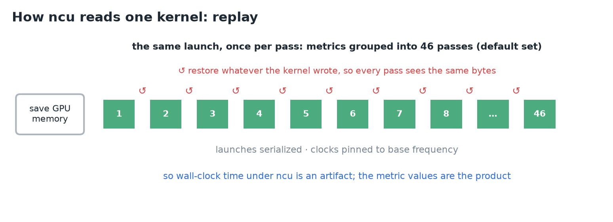
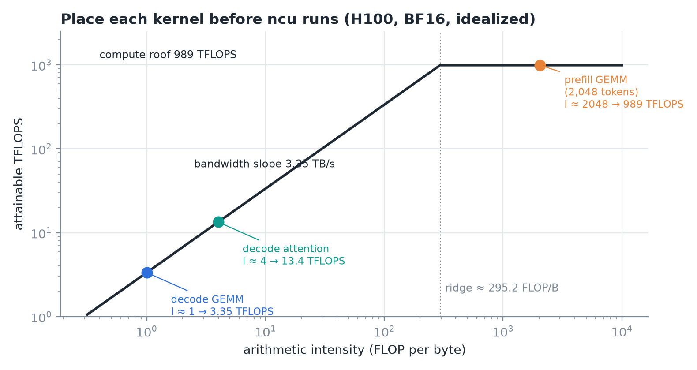
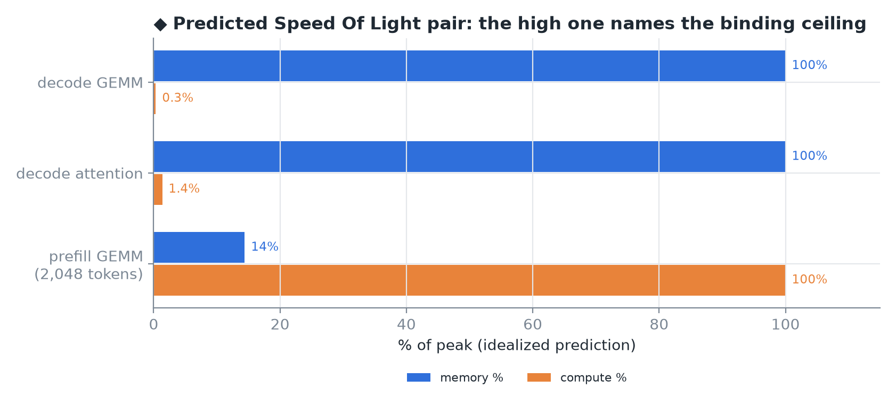
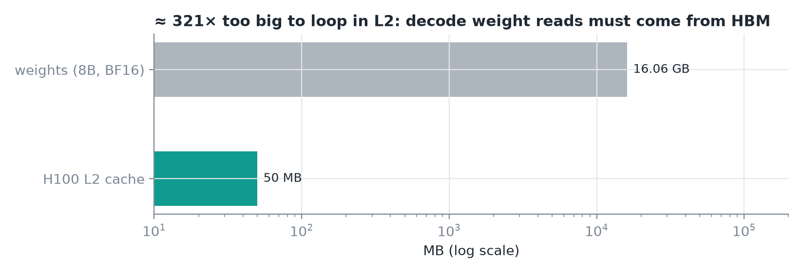
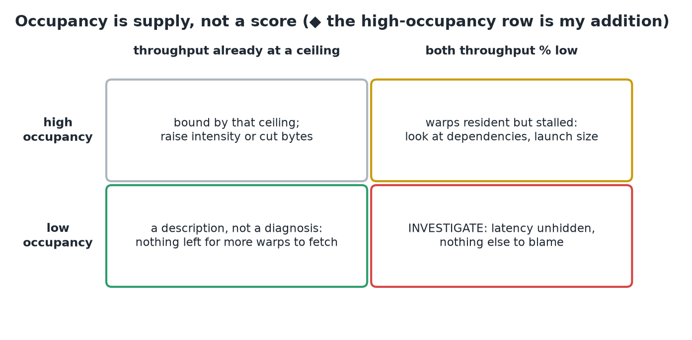
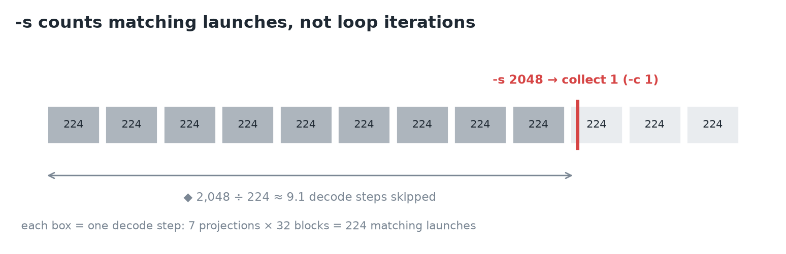
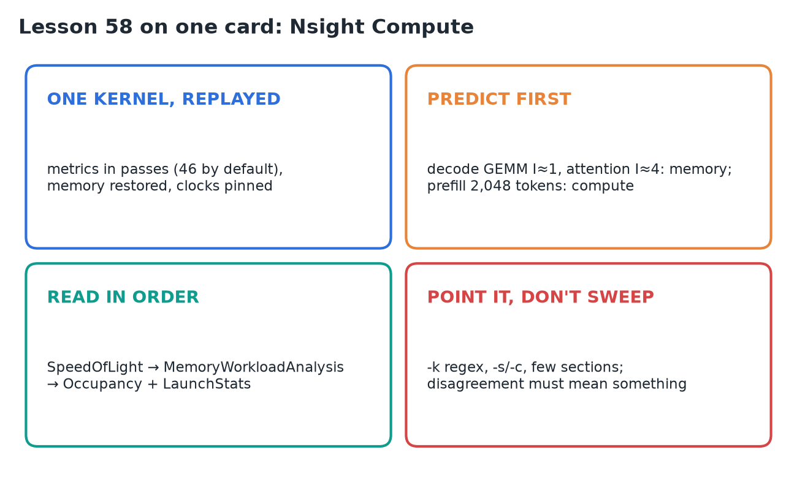

# 58 · Nsight Compute

**Source:** [fanout.sh / inference-eng / 12-04](https://fanout.sh/inference-eng/curriculum/12-04) · ~7 min (text lesson)

> [!NOTE]
> Once a cheaper profiler has **named** the kernel that owns the time, **Nsight Compute** (`ncu`) reads that **one kernel launch exhaustively**, measured against the machine's own maxima. It gets that depth by **replaying** the launch once per group of metrics (46 passes for the default set), with memory restored and clocks pinned, so the **wall-clock time is an artifact** and only the metric values count. The method is to **predict the bound first** with the roofline, then read the report in order: **Speed Of Light**, **memory workload**, **occupancy**. Point it at one suspect; never sweep a server with it.

## 1. Replay and its cost


*One launch, many passes, every pass on the same bytes.*

- A GPU can't collect every counter at once (limited hardware counters; some metrics need patched instructions). So `ncu` groups the requested metrics into **passes** and **replays the same launch once per pass**.
- Before the first pass it **saves all GPU memory** the kernel can touch; between passes it **restores** what the kernel wrote.
- It **serializes** kernel launches and tries to **pin clocks to base frequency**, so passes agree and the result doesn't depend on where in the app the kernel ran.
- NVIDIA's quickstart: a vector-add app with two kernels (4,471 blocks × 256 threads, for 1,144,477 elements); **each kernel ran 46 times** for the default metric set.

> [!WARNING]
> A run under `ncu` is serialized, replayed and clock-pinned. Its elapsed time says nothing about your service latency; **the metric values are the product**.

## 2. Predict the report before it prints


*Three inference kernels placed on the H100 roofline from counts alone.*

$$I_{\mathrm{ridge}} = \frac{989\ \mathrm{TFLOPS}}{3.35\ \mathrm{TB/s}} \approx 295.2\ \mathrm{FLOP/byte}$$

- **Decode GEMM** (weights × a few tokens): intensity **≈ 1 FLOP/byte**. At full bandwidth that's 3.35 TFLOPS, about **⅓ of 1%** of the compute ceiling. A good decode GEMM is **pinned to the memory side** with compute nearly idle.
- **Prefill GEMM at 2,048 tokens**: intensity ≈ the prompt length, the crossing is at ≈ 295 tokens, so it sits **≈ 7× past the ridge**. The **compute ceiling binds** and memory stops being the story.
- **Decode attention**: reads the cached K/V. Each 2-byte cached value costs 2 FLOPs per query head that uses it, and with GQA **4 query heads share each read**: ≈ **4 FLOPs per byte**. Above the weight stream's intensity, but still **≈ 74× short** of the ridge, so still memory-bound.

$$I_{\mathrm{attn}} \approx \frac{2\ \mathrm{FLOPs} \times 4\ \mathrm{heads}}{2\ \mathrm{bytes}} = 4\ \mathrm{FLOP/byte} \quad \Rightarrow \quad \frac{295.2}{4} \approx 74\times\ \mathrm{below\ the\ ridge}$$

- If the report **agrees**, it's confirmation. If it **disagrees**, either the probe is wrong (a name filter matched the wrong kernel, a cold first launch) or it's teaching you something: traffic you assumed came from HBM is being served from somewhere closer.

## 3. Speed Of Light


*◆ My idealized predictions of the two percentages for each kernel.*

- The first section to read: **`SpeedOfLight`** ("GPU Speed Of Light Throughput"). Two headline numbers: **compute %** and **memory %**, each the achieved utilization against the theoretical maximum.
- **Whichever is high names the binding ceiling.** It's the roofline division, measured.
- Metric names are a base plus a suffix, e.g. compute is `sm__throughput.avg.pct_of_peak_sustained_elapsed`.
- **`SpeedOfLight_RooflineChart`** draws the same roofline (log FLOP/s against log intensity, sloped bandwidth line, flat peak, a ridge) with the kernel as a **measured point**.
- The docs' reading rule: a point **on the bandwidth line below the ridge** can only gain FLOP/s if its **intensity rises** too.

## 4. Memory workload analysis


*Weights are far too large for the cache to help decode.*

- When memory % is high, **`MemoryWorkloadAnalysis`** says where the pressure sits: units kept busy, bandwidth between them exhausted, or memory-instruction issue rate at its limit.
- Two numbers matter most for decode-shaped kernels:
  - **achieved device-memory throughput** (bytes/s), read against **3.35 TB/s**;
  - **L2 hit rate**: share of requested sectors served from L2 without going to HBM.
- Expectations: **16.06 GB of weights vs a 50 MB L2**, ≈ **321×**, so weights can't loop in the cache; every decode step streams them from HBM. The KV cache streams the same way.
- A kernel you expected to stream that shows a **high hit rate** is the disagreement case: some bytes you counted never left the cache, so **redo the bound** before trusting the report.

## 5. Occupancy and launch statistics


*Read occupancy next to the Speed Of Light pair, never alone.*

- **Occupancy** asks whether each SM held enough resident warps to **hide latency**. The **`Occupancy`** section reports it twice: **theoretical** (from the launch's budgets) and **achieved** (from execution). A big gap means a **highly imbalanced workload**.
- **`LaunchStats`** prints the configuration: grid, blocks, requested resources.
- Limiter metrics turn the number into a cause, one per budget:
  - `launch__occupancy_limit_registers`
  - `launch__occupancy_limit_shared_mem`
  - `launch__occupancy_limit_warps`
  - `launch__occupancy_limit_blocks`
- The reading ends in something a kernel author can act on: **registers per thread**, **shared memory per block**, **block size**.

> [!CAUTION]
> **Low occupancy doesn't convict a kernel.** If memory throughput already sits at its ceiling, extra warps have nothing to fetch, so low occupancy is a description, not a diagnosis. Investigate when occupancy is low **and both throughput percentages are low too**: latency is going unhidden with nothing else to blame.

## 6. The command line

```bash
ncu --section SpeedOfLight \
    --section MemoryWorkloadAnalysis \
    --section Occupancy --section LaunchStats \
    -k regex:"gemm" -s 2048 -c 1 \
    -o decode-gemm python decode_step.py
```

| Flag | Meaning |
|---|---|
| `-k regex:"gemm"` | filter kernels by name (quoted for the shell). Use a name the cheaper tools showed you: fast math-library kernels don't always contain "gemm" |
| `-s 2048 -c 1` | skip 2,048 **matching launches**, then collect 1 |
| `--section …` | pick the questions by identifier (default: the basic set) |
| `-o decode-gemm` | writes `decode-gemm.ncu-rep`; reopen with `ncu --import` or the UI |


*◆ How far into the run `-s 2048` lands.*

- The skip counts **matching launches, not loop iterations**. A decode step launches a matching GEMM at least once per projection: **7 per block × 32 blocks = 224 per step**. So a skip that clears the cold start is sized in the **thousands**; when in doubt, do a first unfiltered run.
- **Cost discipline**: every section adds metrics, more metrics mean more passes, and the first profiled kernel in a context pays a one-time setup cost. Collect **as few kernels and metrics as the question needs**.

> [!IMPORTANT]
> Point `ncu` at one kernel the cheaper tools already named. Decide what the two Speed Of Light percentages should be **before** it prints them, so a disagreement means something.

## 7. Recap


