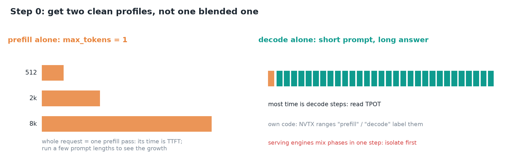
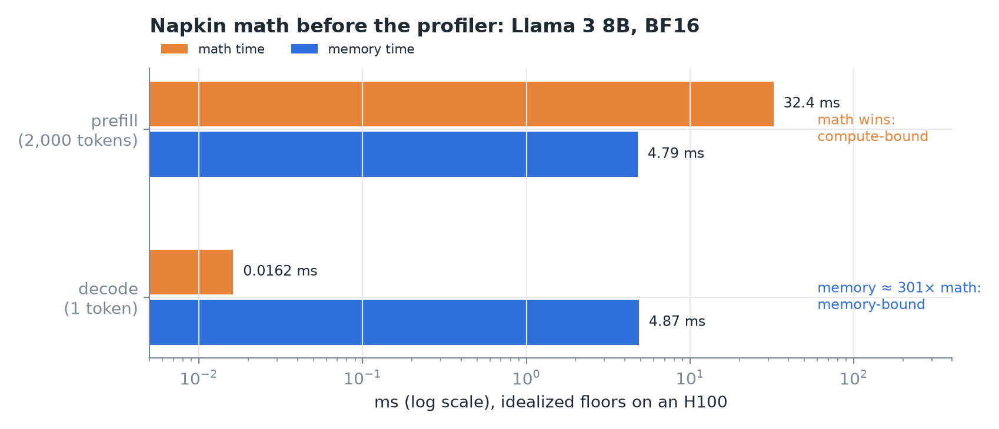
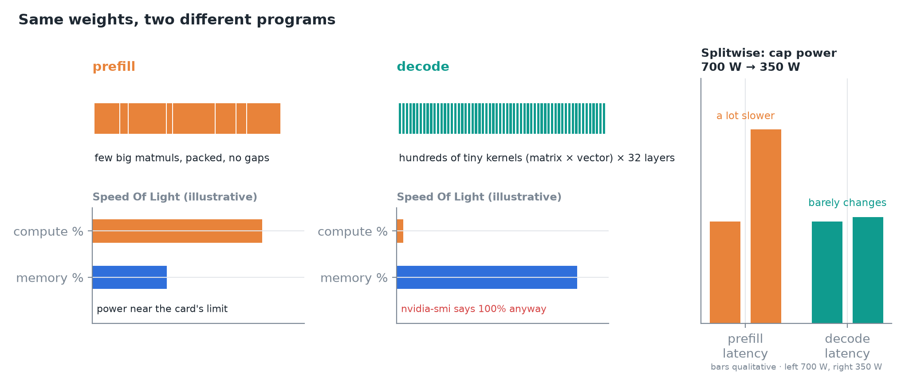
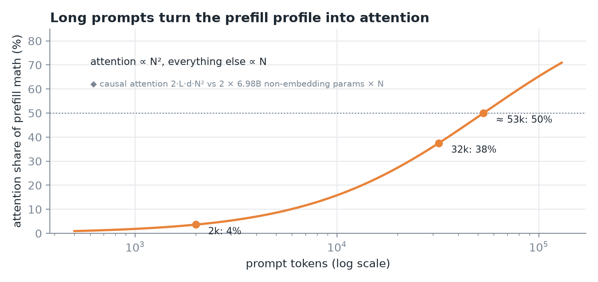
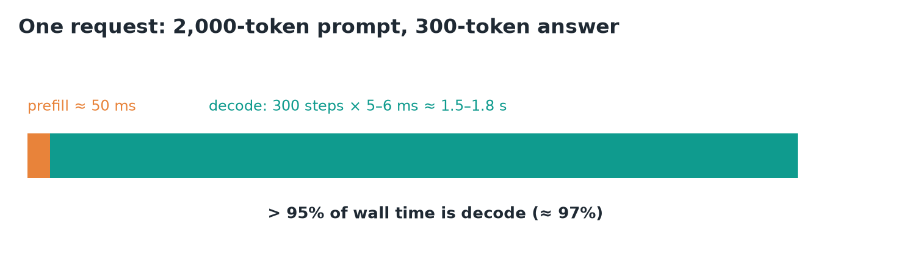
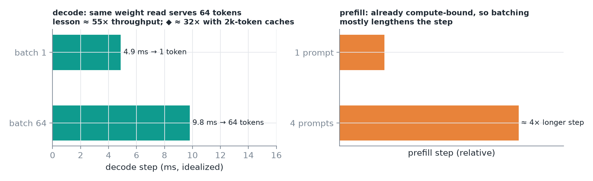
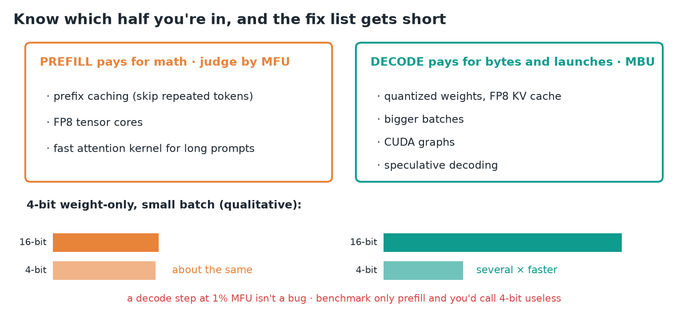
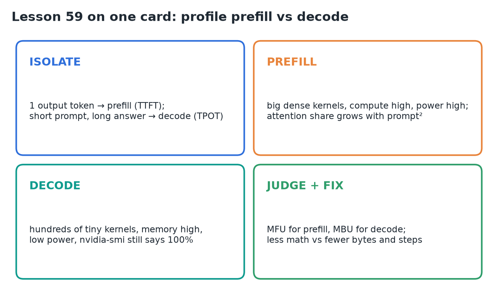

# 59 · Profile Prefill vs Decode

**Source:** [fanout.sh / inference-eng / 12-05](https://fanout.sh/inference-eng/curriculum/12-05) · ~9 min

> [!NOTE]
> Prefill and decode run the **same weights** but are **two different programs** on the GPU. Prefill pushes thousands of tokens through big matrix multiplies and is **compute-bound**; decode pushes one token per request through hundreds of tiny kernels and is **memory-bound**. So **profile them separately**, predict each with napkin math first, judge prefill by **MFU** and decode by **MBU**, and pick fixes that match: **less math** for prefill, **fewer bytes and fewer steps** for decode.

## 1. Get two clean profiles

*One profile per phase, never a blend.*

- **Prefill alone:** send a prompt with **`max_tokens = 1`**. The whole request is one prefill pass, so its time is **TTFT**. Repeat at a few prompt lengths to see how it grows.
- **Decode alone:** a **short prompt and a long answer**, so almost all time is decode steps; read **TPOT**.
- In your own code, wrap each phase in **NVTX ranges** ("prefill", "decode") so they show as labeled bands on the Nsight Systems timeline.
- Serving engines **mix both phases in one step** (chunked prefill, continuous batching), so a production trace blends them. Isolate first, then look at the mix.

## 2. Napkin math first

*Llama 3 8B in BF16 on an H100 (989 TFLOPS, 3.35 TB/s).*

$$t_{\mathrm{prefill,math}} = \frac{2 \times 8\mathrm{B} \times 2{,}000}{989\ \mathrm{TFLOPS}} = \frac{32\ \mathrm{TFLOP}}{989\ \mathrm{TFLOPS}} \approx 32\ \mathrm{ms} \quad \mathrm{vs} \quad \frac{16\ \mathrm{GB}}{3.35\ \mathrm{TB/s}} \approx 4.8\ \mathrm{ms}$$

$$t_{\mathrm{decode,mem}} = \frac{16.06\ \mathrm{GB} + 0.26\ \mathrm{GB\ KV}}{3.35\ \mathrm{TB/s}} \approx 4.9\ \mathrm{ms} \quad \mathrm{vs} \quad \frac{16\ \mathrm{GFLOP}}{989\ \mathrm{TFLOPS}} \approx 0.016\ \mathrm{ms}$$

- **Prefill** reads the weights once and does math for every prompt token: math ≈ 32 ms against < 5 ms of reading. **Compute-bound.**
- **Decode** reads all weights plus the cache to produce **one token**: ≈ 4.9 ms of reading against 0.016 ms of math, **≈ 300×**. **Memory-bound by hundreds of times.**
- The lesson rounds peak to about 1,000 TFLOPS (≈ 33 ms) and decode to ≈ 5 ms. Both check out.
- ◆ The 0.26 GB of KV is a 2,000-token cache at 128 KB per token (32 layers × 8 KV heads × 128 dims × 2 for K and V × 2 bytes).

## 3. The prefill profile

*Same model, two traces. Speed Of Light bars are illustrative.*

- **Timeline:** a few **big dense matmul kernels**, packed back to back, **no gaps**.
- **Nsight Compute Speed Of Light:** **compute % high**, memory % lower.
- **Power** sits near the card's limit: the tensor cores are actually working.
- **Splitwise** (power cap from 700 W to 350 W): prefill latency gets **a lot slower**, decode **barely changes**. Power-hungry means compute-bound.

*Computed for Llama 3 8B.*

- Attention math grows with **N²**, everything else with **N**. So the profile shifts with prompt length:
  - **2k tokens:** attention ≈ **4%** of prefill math; the profile is matmuls.
  - **32k tokens:** ≈ **38%**.
  - **≈ 53k tokens:** **50%**; attention is half the bill.
- ◆ Checked: causal attention costs 2·L·d·N² FLOPs (QKᵀ and AV, half the matrix), the rest 2 × 6.98B non-embedding parameters × N. That gives 3.6%, 37.5% and a crossover at ≈ 53,250 tokens.

$$\frac{\mathrm{attention}}{\mathrm{total}} = \frac{2 L d N^2}{2 L d N^2 + 2 P N} = 50\% \quad \Rightarrow \quad N = \frac{P}{L d} = \frac{6.98\mathrm{B}}{32 \times 4096} \approx 53\mathrm{k}$$

## 4. The decode profile

- **Timeline:** **hundreds of tiny kernels** per step (norm, QKV, RoPE, attention, output projection, norm, MLP, repeated for 32 layers). Each is a **matrix times one vector**.
- **Speed Of Light:** **memory % high, compute % tiny.**
- **nvidia-smi says 100% utilization.** It only means some kernel was running, not that the tensor cores were busy.
- **Without CUDA graphs** there are **gaps** between those small kernels (CPU launch overhead). Engines that capture graphs show **one graph launch per step** instead.

> [!WARNING]
> "100% GPU utilization" on a decode workload tells you nothing. Read memory % and MBU instead.

## 5. Where the wall time goes

*2,000-token prompt, 300-token answer.*

- Prefill ≈ **50 ms**; decode **300 steps × 5–6 ms ≈ 1.6 s**. Decode is **> 95%** of the request (≈ 97%).
- Splitwise reports the same at fleet scale: **most end-to-end time is token generation**.
- Prefill still matters: it **sets TTFT**, and in a mixed step it **delays the decodes** that share it.

## 6. Add load

*Batching helps the phase that was waiting on memory.*

- **Decode, batch 1 → 64:** the step gets only **slightly longer**, because the weight read is shared by 64 tokens. Throughput rises **≈ 55×** in the lesson's example.
- ◆ How far the gain holds depends on context length: with a **2,000-token cache per request**, 64 caches add 16.8 GB, the step goes from ≈ 4.9 to ≈ 9.8 ms and the gain is **≈ 32×**. Short contexts get closer to 64×.
- **Prefill, 1 → 4 prompts:** already compute-bound, so the step gets **≈ 4× longer**. Little throughput gain.

## 7. Judge and fix by phase

*The 4-bit bars are qualitative.*

- **Yardsticks:** **MFU** for prefill, **MBU** for decode. A decode step at **1% MFU is normal**, not a bug.
- **Prefill pays for math:**
  - **prefix caching** (skip tokens already computed);
  - **FP8 tensor cores**;
  - **fast attention kernels** for long prompts.
- **Decode pays for bytes and launches:**
  - **quantized weights, FP8 KV cache**;
  - **bigger batches**;
  - **CUDA graphs**;
  - **speculative decoding** (more tokens per weight read).
- **4-bit weight-only example:** prefill stays **about the same** (it wasn't waiting on bytes); decode gets **several times faster**. Benchmark only prefill and you'd call 4-bit useless.

> [!IMPORTANT]
> First ask which phase owns the time, then which resource that phase is bound on. The fix list follows from those two answers.

## 8. Recap

