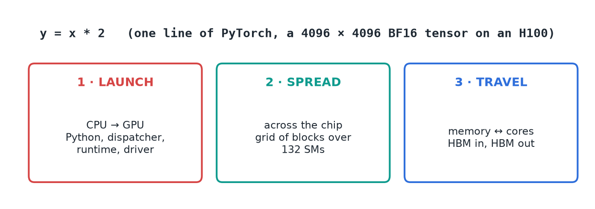
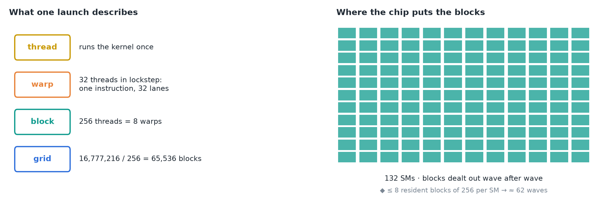
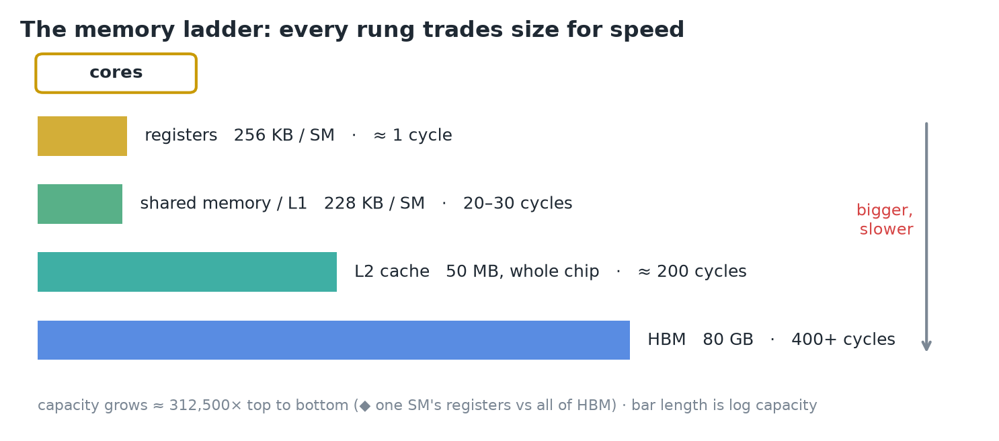
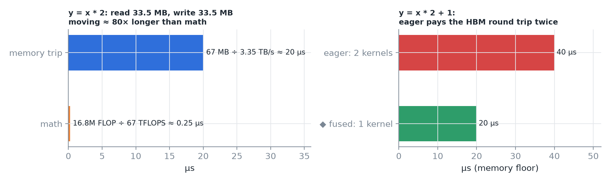
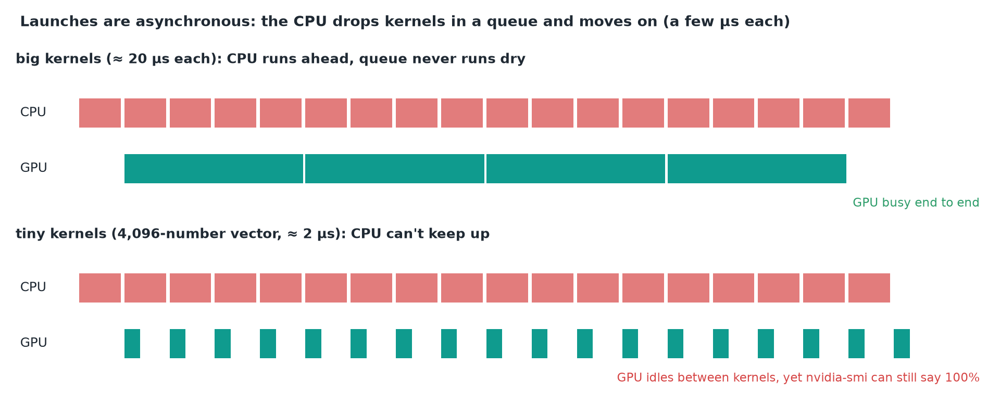
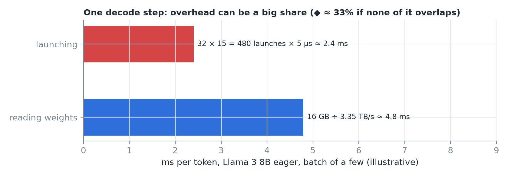
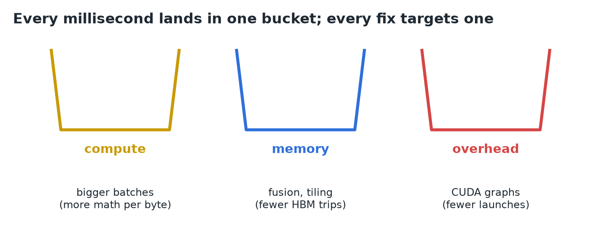
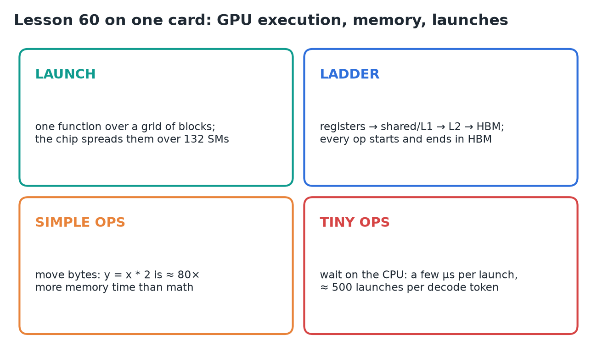

# 60 · GPU Execution, Memory Hierarchy & Kernel Launches

**Source:** [fanout.sh / inference-eng / 12-06](https://fanout.sh/inference-eng/curriculum/12-06) · ~7 min

> [!NOTE]
> Even `y = x * 2` on an H100 pays **three separate costs**: the CPU must **launch** a kernel, the GPU must **spread** the work over its 132 SMs, and the numbers must **travel** from HBM to the cores and back. Any one of them can be what makes a model slow. Simple ops spend their time **moving bytes**; tiny ops spend it **waiting on the CPU**. That gives every millisecond three buckets: **compute, memory, overhead**.

## 1. Three costs behind one line

*Each step can be the bottleneck.*

- **Launch:** the CPU tells the GPU to run a kernel.
- **Spread:** the GPU distributes the work across the chip.
- **Travel:** inputs come from memory to the cores, outputs go back.

## 2. How work spreads over the chip

*The launch says what and how many; the chip says where.*

- An H100 is not one big processor: it's **132 streaming multiprocessors (SMs)** laid out like tiles.
- A **kernel** is one function the GPU runs many times at once, **once per thread**.
- **Warp:** 32 threads in **lockstep** (one instruction, 32 lanes). Warps pack into **blocks**; all blocks of one launch form the **grid**.
- Example: x is 4096 × 4096 = **16,777,216** numbers. At **256 threads per block**, the grid is **65,536 blocks**.
- The hardware deals blocks to SMs **wave after wave** until all are done.
- ◆ An SM holds at most 2,048 resident threads, so ≤ 8 blocks of 256 at once: 132 × 8 = 1,056 blocks per wave, ≈ **62 waves**.

## 3. The memory ladder

*Every rung trades size for speed.*

| Rung | Size | Latency |
|---|---|---|
| registers | 256 KB per SM | ≈ 1 cycle |
| shared memory / L1 | up to 228 KB per SM | 20–30 cycles |
| L2 cache | 50 MB, whole chip | ≈ 200 cycles |
| HBM | 80 GB (what nvidia-smi shows) | 400+ cycles |

- Top to bottom, capacity grows **≈ 300,000×**. ◆ That's one SM's 256 KB of registers against all 80 GB of HBM (312,500×); the whole chip's registers (132 × 256 KB ≈ 34 MB) are only ≈ 2,400× smaller than HBM.

> [!IMPORTANT]
> A normal PyTorch op **starts with its inputs in HBM and ends with its output in HBM**. Nothing stays on the chip between operations.

## 4. Price the line

*Bytes, not math, set the time.*

$$t_{\mathrm{mem}} = \frac{33.5\ \mathrm{MB} + 33.5\ \mathrm{MB}}{3.35\ \mathrm{TB/s}} \approx 20\ \mathrm{\mu s} \quad \mathrm{vs} \quad t_{\mathrm{math}} = \frac{16.8\mathrm{M}\ \mathrm{FLOP}}{67\ \mathrm{TFLOPS}} \approx 0.25\ \mathrm{\mu s}$$

- Read x (16.8M × 2 bytes in BF16 = **33.5 MB**), write y (**33.5 MB**): **67 MB** of traffic.
- Math at the H100's **67 TFLOPS of ordinary (non-tensor-core) math**: a quarter of a microsecond.
- Moving takes **≈ 80×** longer than computing. The cores mostly wait for bytes: **memory-bound**.
- `y = x * 2 + 1` in eager PyTorch is **two kernels**, so it pays the HBM round trip **twice** (◆ ≈ 40 µs against ≈ 20 µs if fused into one).

## 5. Launch overhead

*Same CPU launch rate, very different GPU timelines.*

- A launch walks **Python → PyTorch's C++ dispatcher → CUDA runtime → driver → GPU**. That's **a few µs per launch**, the same for huge or tiny kernels.
- Launches are **asynchronous**: the CPU drops kernels into a queue and moves on, so it can **run ahead** of the GPU.
- **Big kernels** (the 20 µs multiply): the CPU stays ahead and the queue never runs dry.
- **Tiny kernels** (a single 4,096-number vector, ≈ 2 µs): the CPU can't keep up. The GPU finishes each kernel and **sits idle** waiting for the next launch.

> [!WARNING]
> **nvidia-smi can still show 100% utilization** here. It only means some kernel was running during the sample, not that the chip was busy.

## 6. One decode step

*The lesson's numbers are illustrative; the shape is real.*

- Generating one token runs every layer on a handful of vectors: **lots of small kernels**.
- Llama 3 8B: **32 layers × ≈ 15 kernels** in plain eager mode ≈ **500 launches per token**.
- At ≈ **5 µs each**, launching alone is ≈ **2.5 ms** (480 × 5 = 2.4 ms).
- Reading **16 GB** of weights at 3.35 TB/s is ≈ **4.8 ms**.
- So a **big share of each token can be overhead**, neither math nor memory. ◆ If none of it overlapped, ≈ 33% of the step.

## 7. Three buckets, one fix each

- **Compute:** **bigger batches** give the math more to do per byte.
- **Memory:** **fusion and tiling** cut HBM round trips.
- **Overhead:** **CUDA graphs** cut launches.

## 8. Recap

