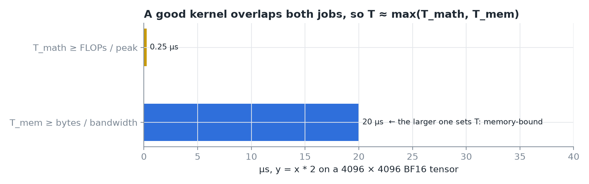
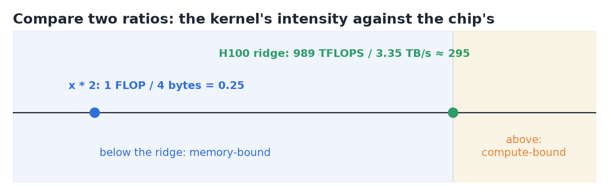
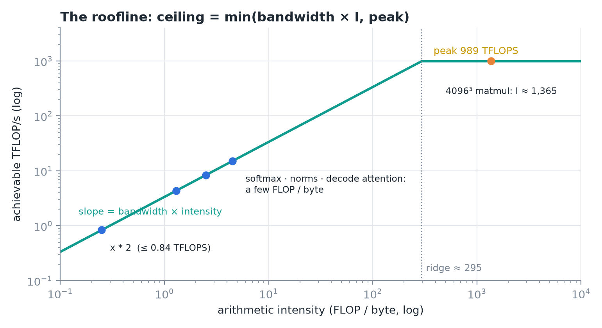
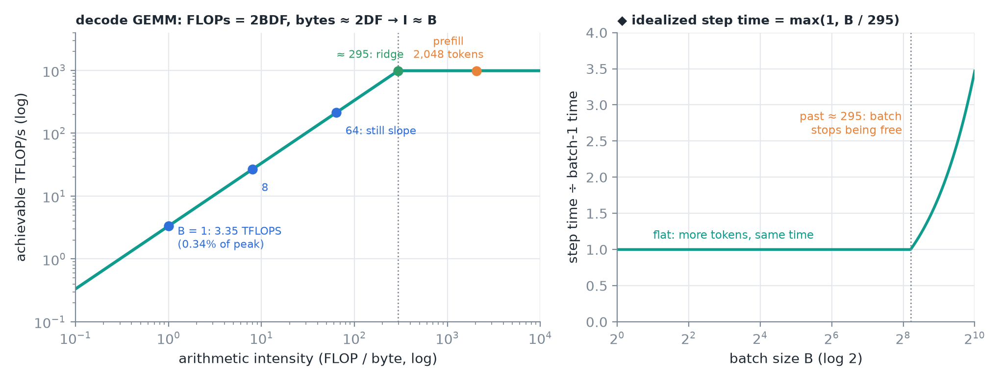
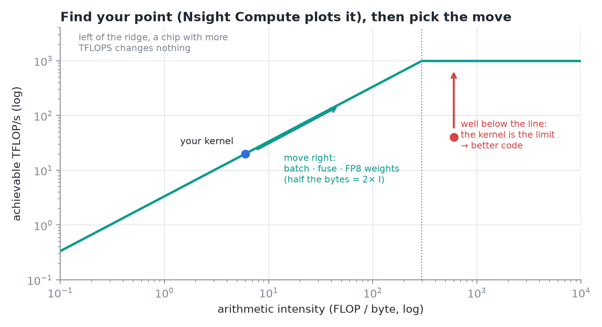
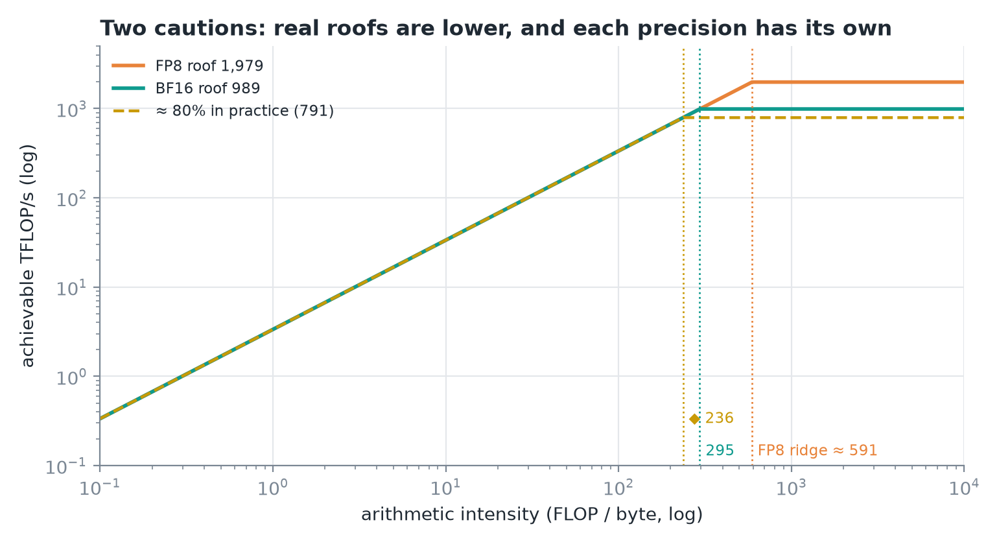
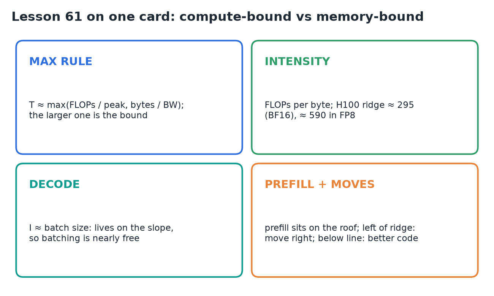

# 61 · Compute-Bound vs Memory-Bound & the Roofline Model

**Source:** [fanout.sh / inference-eng / 12-07](https://fanout.sh/inference-eng/curriculum/12-07) · ~6 min

> [!NOTE]
> Every kernel does some math and moves some bytes, and takes about as long as the **larger** of the two. Compare the kernel's **arithmetic intensity** (FLOPs per byte) to the chip's **ridge point** (peak FLOPS ÷ bandwidth, ≈ **295** on an H100 in BF16): below it you're **memory-bound** and more TFLOPS changes nothing; above it you're **compute-bound** and more bandwidth changes nothing. The **roofline** plots this. Decode GEMMs have intensity ≈ **batch size**, so they live on the slope and batching is nearly free; prefill lives on the roof.

## 1. The max rule

*The multiply-by-two kernel on an H100.*

$$T_{\mathrm{math}} \geq \frac{\mathrm{FLOPs}}{\mathrm{peak\ FLOPS}} \qquad T_{\mathrm{mem}} \geq \frac{\mathrm{bytes}}{\mathrm{bandwidth}} \qquad T \approx \max(T_{\mathrm{math}},\ T_{\mathrm{mem}})$$

- A good kernel **overlaps** the two jobs, so the total is about the larger one.
- **Math bigger → compute-bound. Bytes bigger → memory-bound.**
- `y = x * 2`: math ≈ **0.25 µs**, bytes ≈ **20 µs**. Memory-bound by a mile.

## 2. Two ratios instead of two times

*Kernel intensity against the chip's ridge.*

$$I = \frac{\mathrm{FLOPs}}{\mathrm{bytes\ moved}} \qquad I_{\mathrm{ridge}} = \frac{989\ \mathrm{TFLOPS}}{3.35\ \mathrm{TB/s}} \approx 295\ \mathrm{FLOP/byte}$$

- **Arithmetic intensity:** how much math a kernel does per byte it touches. Multiply by two does **1 FLOP per 4 bytes** (2 read, 2 written in BF16): **I = 0.25**.
- **The chip's ratio:** to keep the math units busy, every byte brought in must pay for **≈ 295 operations**.
- **Below the ridge: memory-bound. Above: compute-bound.**

## 3. The roofline

*Both axes log scale.*

- Horizontal: intensity. Vertical: achievable FLOPS.
- **Memory-bound ceiling:** bandwidth × intensity, a **slanted line**.
- **Compute-bound ceiling:** the chip's peak, a **flat roof**.
- Your ceiling is the **lower** of the two; they meet at the **ridge (295)**.
- Where real ops land:
  - **elementwise multiply** (I = 0.25): far down the slope, capped at **≤ 0.84 TFLOPS**;
  - **softmax, layer norms, single-token attention**: a few FLOPs per byte, also on the slope;
  - **4096 × 4096 square matmul**: I **> 1,000** (◆ 2N³ FLOPs ÷ 3 × 2N² bytes ≈ 1,365), up on the roof.

## 4. Why this picture runs inference

*The right panel is my idealized model of a decode GEMM's step time.*

$$\mathrm{FLOPs} = 2BDF \qquad \mathrm{bytes} \approx 2DF \qquad \Rightarrow \qquad I \approx B$$

- In decode, the biggest kernels multiply **B token vectors** by a huge **D × F weight matrix**.
- FLOPs grow with the batch, but the bytes are almost all **weights, read once no matter the batch**. So **intensity ≈ batch size**.
- **B = 1:** I ≈ 1, capped at **3.35 TFLOPS**, about **⅓ of 1%** of peak.
- **Grow the batch:** the point slides up the slope; each step gives **more tokens for almost the same time**.
- **B = 64:** still memory-bound; 64 tokens instead of 1 for about the same time.
- **A few hundred (≈ 295):** the point reaches the ridge and **batching stops being free**.
- **Prefill** is the other extreme: thousands of prompt tokens are one giant batch, **on the roof**.

## 5. Using the roofline

*Two different diagnoses, two different moves.*

- **Find your point.** Nsight Compute's roofline chart plots each kernel for you.
- **Left of the ridge:** a faster chip's math won't help. **Move right:**
  - **batch** more work together;
  - **fuse** kernels so bytes aren't reloaded;
  - **store weights in fewer bits**: FP8 **halves the bytes and doubles the intensity**.
- **Well below the line:** the hardware isn't the limit, **the kernel is**. That's a job for better code.

## 6. Two cautions

*The datasheet roof is an upper bound.*

- **Real roofs are lower than datasheet roofs:** H100s tend to reach **≈ 80% of peak FLOPS**. ◆ At 80% (≈ 791 TFLOPS) the ridge moves in to ≈ 236.
- **Each precision has its own roof.** In FP8 the peak doubles to **1,979 TFLOPS**, so the ridge moves out to **≈ 590**.
- ◆ FP8 weights double a decode GEMM's intensity (I ≈ 2B), so on the FP8 roof the ridge is still reached at a batch of ≈ 295. With FP8 weights but BF16 math, it's reached at ≈ 148.

> [!IMPORTANT]
> Know which side of the ridge a kernel sits on before optimizing. Left of it, buy bandwidth or move right; right of it, buy FLOPS; far below the line, fix the code.

## 7. Recap

