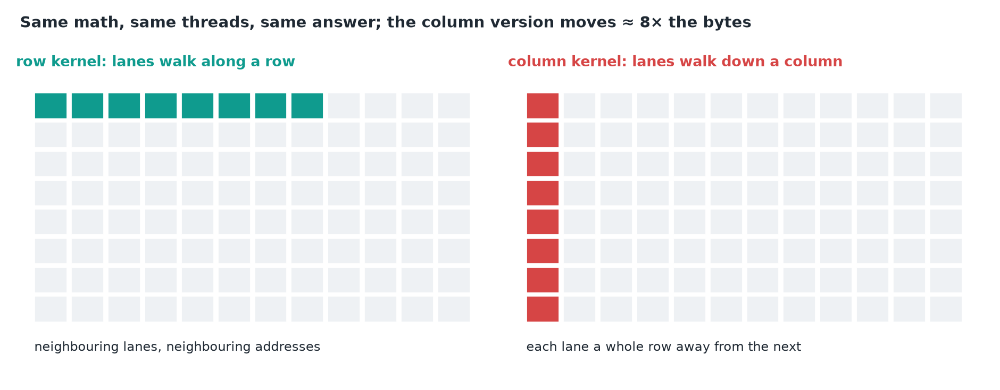
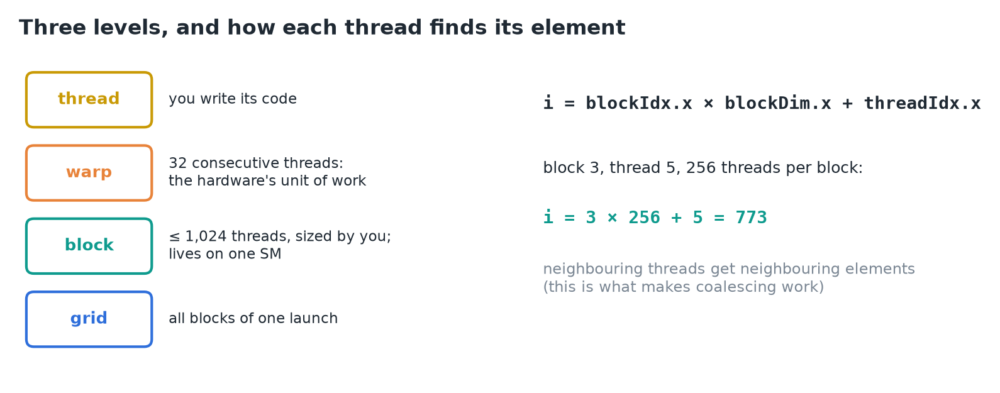
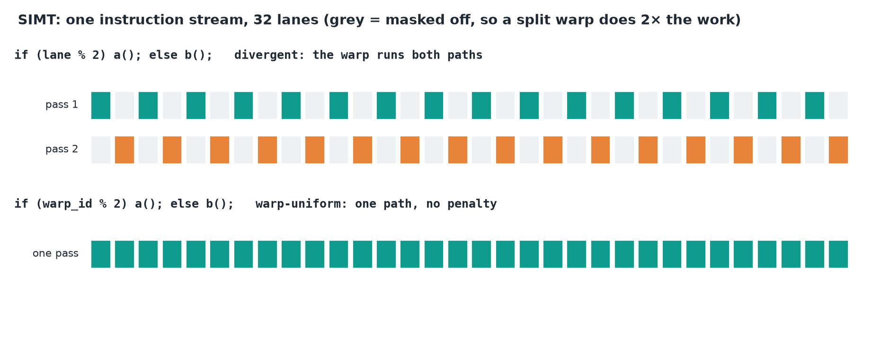
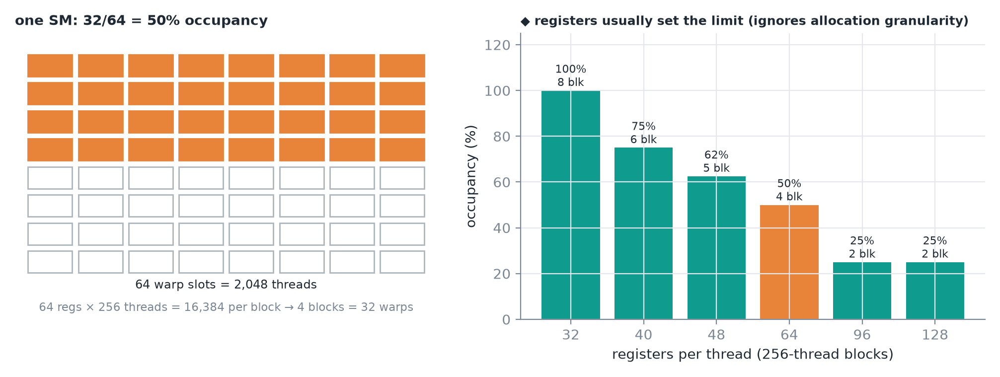
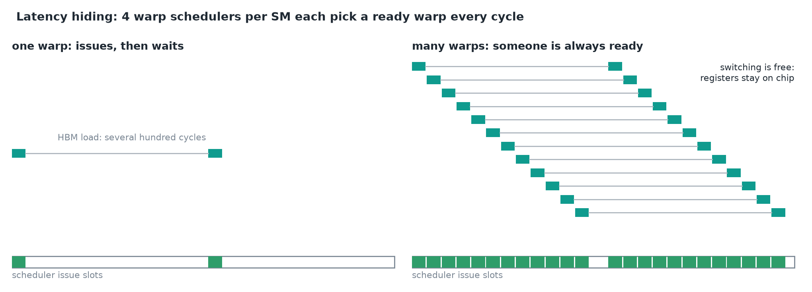
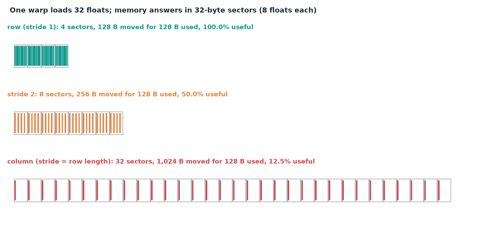
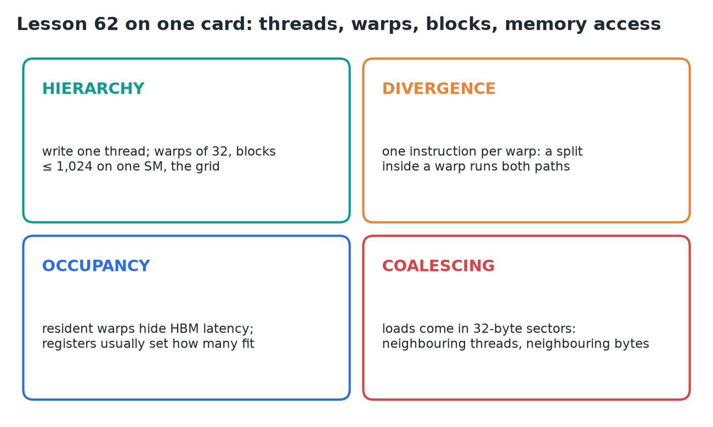

# 62 · GPU Threads, Warps, Blocks & Memory Access

**Source:** [fanout.sh / inference-eng / 13-01](https://fanout.sh/inference-eng/curriculum/13-01) · ~7 min

> [!NOTE]
> You write a GPU kernel for **one thread**, but the hardware runs threads in **warps of 32** that share one instruction, grouped into **blocks** that each live on **one SM**. Four consequences follow. A branch that splits a warp runs **both paths**. Many resident warps let the scheduler **hide memory latency**, and **registers** usually decide how many fit. And a warp's loads arrive in **32-byte sectors**, so **neighbouring threads must read neighbouring addresses**: two kernels with the same math can differ by **8× in bytes moved**.

## 1. Two kernels, same work

*Add 1 to every element of a big matrix.*

- **Row kernel:** each thread gets one number, and neighbouring threads walk **along a row**.
- **Column kernel:** each thread gets one number, and neighbouring threads walk **down a column**.
- Same math, same thread count, same answer. The column version can move **about 8× as many bytes**. The reason is in how the GPU runs threads together, not one at a time.

## 2. Threads, warps, blocks, grid

*Each thread computes its own element from two numbers.*

- **Thread:** you write the code for one; then launch many.
- **Warp:** every **32 consecutive threads**. The hardware's unit of work.
- **Block:** a group of warps, **up to 1,024 threads**, sized by you.
- **Grid:** all the blocks of one launch.
- Each thread finds its element from **which block** it's in and **its position in the block**:

$$i = \mathrm{blockIdx} \times \mathrm{blockDim} + \mathrm{threadIdx} = 3 \times 256 + 5 = 773$$

- **Neighbouring threads get neighbouring elements.** That's what makes section 6 work.

## 3. A warp is one instruction stream

*Divergence only costs you inside a warp.*

- 32 threads in a warp share **one instruction stream**, like a rowing crew: one call, 32 oars. NVIDIA calls it **SIMT** (single instruction, multiple threads). Each lane has its own registers and data, but all execute the same instruction.
- **Divergence:** at an `if` where some lanes go one way and some the other, the warp runs **both paths, one after the other**, with the other lanes **masked off**.
- Branch on **odd vs even thread** and every warp does **double the work**.
- Branch on something **the same for the whole warp** (e.g. the warp index) and there's **no penalty**.

## 4. Blocks on SMs, and occupancy

*Left: the lesson's example. Right: ◆ my sweep over registers per thread.*

- Every block is placed on **one SM** and **stays there until it finishes**. Its threads share that SM's fast **shared memory**.
- An H100 SM holds at most **64 warps = 2,048 threads** at once.
- In practice **registers** set the limit: **65,536 per SM**, shared by every resident thread.

$$64\ \mathrm{regs} \times 256\ \mathrm{threads} = 16{,}384\ \mathrm{per\ block} \quad \Rightarrow \quad \frac{65{,}536}{16{,}384} = 4\ \mathrm{blocks} = 32\ \mathrm{warps} = 50\%\ \mathrm{occupancy}$$

- **Occupancy** = resident warps ÷ maximum warps.
- ◆ Full occupancy needs ≤ 65,536 ÷ 2,048 = **32 registers per thread**. At 128 registers it falls to 25%. Real allocation rounds registers up in chunks, so the true numbers can be slightly lower.

## 5. Why more warps help: latency hiding

*Illustrative timelines.*

- A load from HBM takes **several hundred cycles**. A single warp that asks for data just waits.
- Each SM has **4 warp schedulers**, and each picks a **ready warp every cycle**. When one warp stalls on memory, the scheduler issues from another.
- **Switching is free:** every resident warp keeps its registers on chip, so nothing is saved or restored.
- With enough warps in flight, the waiting hides behind other warps' work and the **memory system stays busy**.

> [!CAUTION]
> Occupancy isn't a score to maximize. **FlashAttention** deliberately runs **fewer warps** so each can hold more data on chip. Low occupancy only hurts when there aren't enough warps left to hide the latency.

## 6. Coalescing

*One warp loading 32 four-byte floats.*

- When a warp loads, its **32 requests are combined**, and memory returns data in **32-byte sectors** (8 floats each).
- **Row kernel:** thread 0 wants element 0, thread 1 element 1, and so on: 32 floats side by side, **128 bytes = 4 sectors**. Every byte moved is used.
- **Stride 2:** the warp touches **8 sectors**, and half of each is wasted (**50%** useful).
- **Column kernel:** each thread's element is a whole row from its neighbour's, so **every thread lands in its own sector**: **32 sectors, 1,024 bytes moved to use 128**, **12.5%** useful.

$$\frac{32\ \mathrm{sectors} \times 32\ \mathrm{B}}{32\ \mathrm{floats} \times 4\ \mathrm{B}} = \frac{1{,}024}{128} = 8\times\ \mathrm{the\ bytes}$$

- The kernel is memory-bound, so **8× the bytes can make it close to 8× slower**. Same math, different addresses.

> [!IMPORTANT]
> **Coalescing:** neighbouring threads should touch neighbouring addresses.

## 7. Recap

