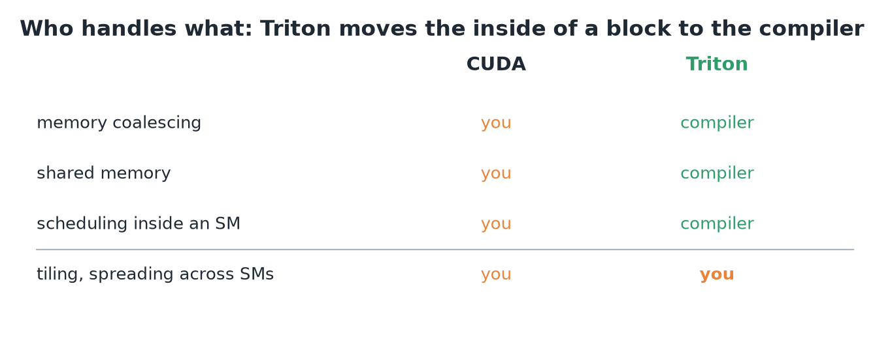
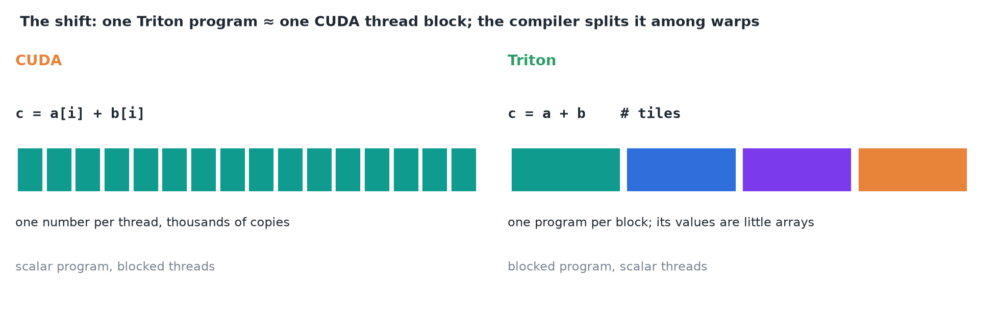
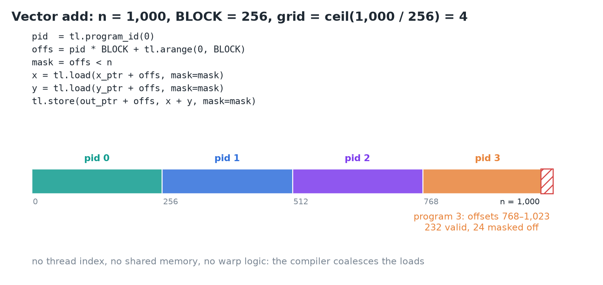
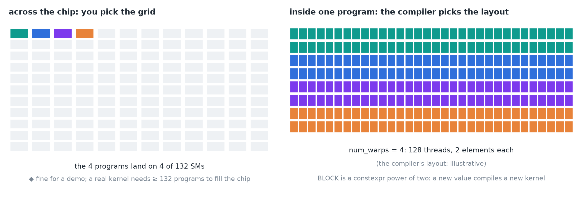
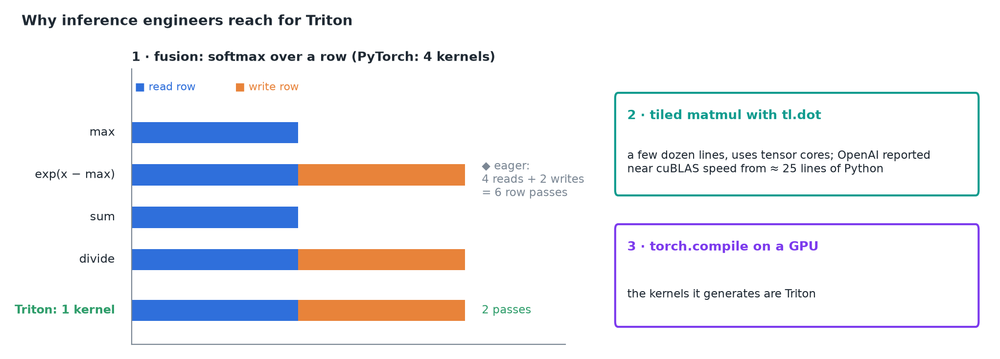
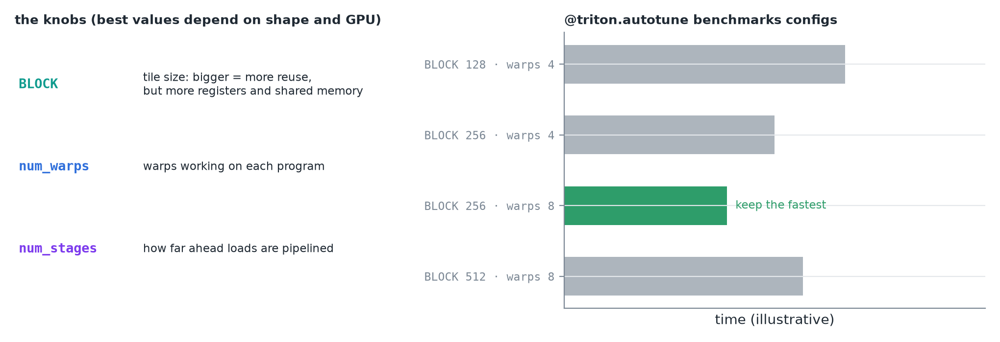
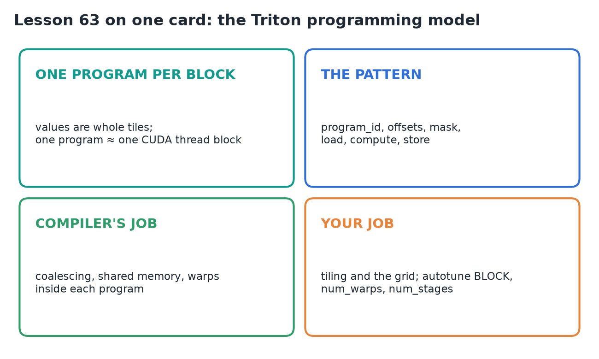

# 63 · Writing GPU Kernels in Triton: Programming Model

**Source:** [fanout.sh / inference-eng / 13-02](https://fanout.sh/inference-eng/curriculum/13-02) · ~6 min

> [!NOTE]
> **Triton** is OpenAI's Python-embedded kernel language. In CUDA you write the code for **one thread** and manage coalescing, shared memory and in-SM scheduling yourself. In Triton you write **one program per block of data**, its variables are **whole tiles**, and the **compiler** handles what happens inside the block. Almost every kernel follows one pattern: **program id, offsets, mask, load, compute, store**. Inference engineers use it for **fusion** (softmax in one HBM read and one write), **tiled matmuls** near cuBLAS speed, and because **torch.compile** emits Triton. The tiling and the grid remain your job.

## 1. What moves to the compiler


*Everything inside a block becomes the compiler's job.*

- **Compiler's job in Triton:** memory coalescing, shared memory, scheduling inside each SM.
- **Still yours:** how to cut the problem into blocks, and how those blocks spread across the chip.

## 2. The shift in thinking


*Same addition, two programming models.*

- **CUDA:** a **scalar program**: the code for one thread; the hardware runs thousands of copies.
- **Triton:** a program that handles **a whole block of data at once**. Its variables aren't single numbers, they're **little arrays**.
- Triton's docs: CUDA is a **scalar program with blocked threads**; Triton is a **blocked program with scalar threads**.
- **One Triton program instance ≈ one CUDA thread block.** The compiler decides how the warps inside it split the work.

## 3. Reading the smallest kernel: vector add


*n = 1,000 elements, BLOCK = 256.*

```python
@triton.jit
def add(x_ptr, y_ptr, out_ptr, n, BLOCK: tl.constexpr):
    pid = tl.program_id(0)
    offs = pid * BLOCK + tl.arange(0, BLOCK)
    mask = offs < n
    x = tl.load(x_ptr + offs, mask=mask)
    y = tl.load(y_ptr + offs, mask=mask)
    tl.store(out_ptr + offs, x + y, mask=mask)
```

- **`program_id`:** each running copy asks "which block am I?": 0, 1, 2 or 3.
- **`offsets`:** program id × BLOCK plus a range 0 to 255: a **whole vector of indices** in one line.
- **`mask`:** program 3 gets indices **768 to 1,023**, but there are only 1,000 elements. `offs < n` leaves **232 lanes real** and switches off the **last 24**.
- **`load`, compute, `store`:** one call reads the whole block of x, another reads y, skipping masked lanes; add them as whole blocks; store with the same mask.
- **What's missing:** no thread index, no shared memory, no warp logic. The compiler makes the loads **coalesced**.

## 4. The grid, and inside one program


*Left: ◆ where 4 programs land on an H100. Right: the compiler's layout (illustrative).*

$$\mathrm{grid} = \left\lceil \frac{1{,}000}{256} \right\rceil = 4\ \mathrm{programs}$$

- **You pick the grid** at launch. Each program becomes something like a thread block, and the GPU spreads them across its SMs.
- **Inside each program the compiler chooses the layout.** With `num_warps = 4` that's 128 threads, so each thread might take **2 elements**.
- **BLOCK is a compile-time constant and a power of two.** Change it and Triton compiles a new version.
- The **first call is slower**: that's when the kernel compiles.
- ◆ 4 programs occupy 4 of 132 SMs. Fine for a demo, but a real kernel needs at least as many programs as SMs to fill the chip.

## 5. Why inference engineers reach for Triton


*◆ The row-pass count for eager softmax is my arithmetic.*

1. **Fusion.** Softmax over one row is max, exponentiate, sum, divide. Plain PyTorch runs **4 kernels**, and the row makes several round trips to HBM. In Triton **one program loads the row once**, does every step on chip, and **writes once**. ◆ Eager max reads the row, exp reads and writes it, sum reads it, divide reads and writes it: **6 row passes against 2**, so ≈ 3× the traffic for a memory-bound op.
2. **Matmuls.** With the block-level dot product `tl.dot`, a tiled matmul fits in a few dozen lines and **uses tensor cores**. OpenAI reported matmuls **near cuBLAS speed from about 25 lines of Python**.
3. **torch.compile.** On a GPU model, the kernels it generates **are Triton**.

## 6. The knobs, and one caution


*Autotune timings are illustrative.*

- **`BLOCK`:** tile size. Bigger tiles mean **more reuse**, but **more registers and shared memory** per program.
- **`num_warps`:** how many warps work on each program.
- **`num_stages`:** how far ahead loads are **pipelined**.
- The best values depend on the **shapes and the GPU**, so **`@triton.autotune`** benchmarks a few configurations and keeps the fastest.

> [!CAUTION]
> Triton hides the **inside of a block, not the physics**. Bad tiling, or **too few programs to fill the SMs**, is still your problem.

## 7. Recap


