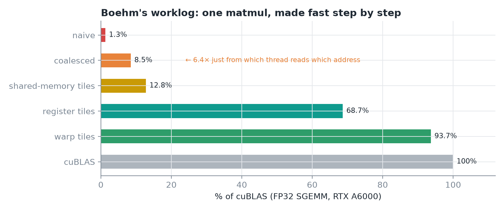
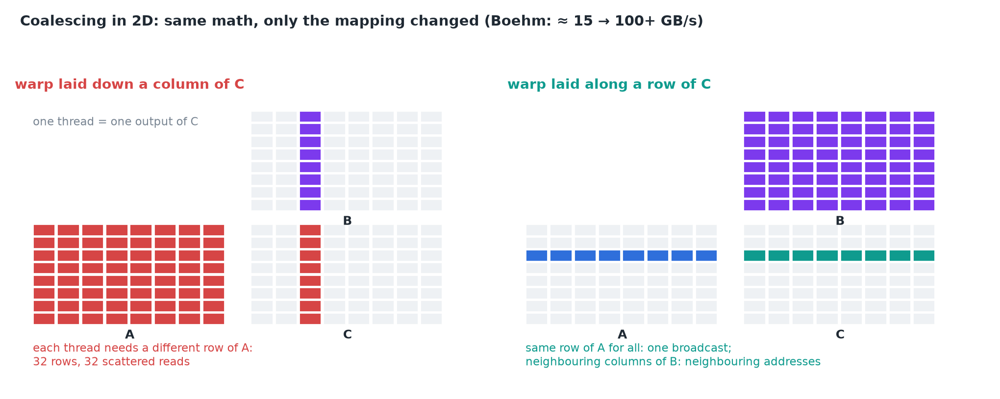
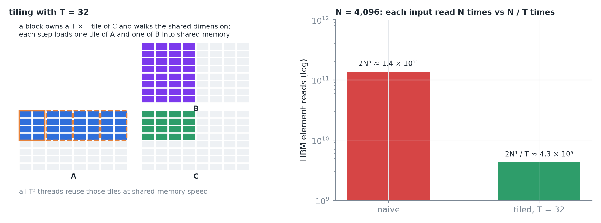
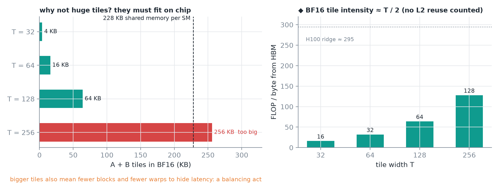
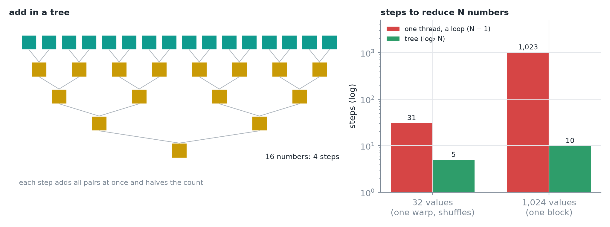
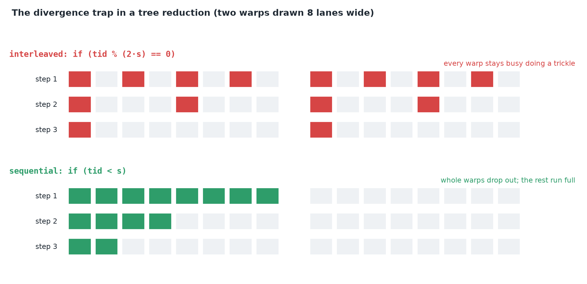
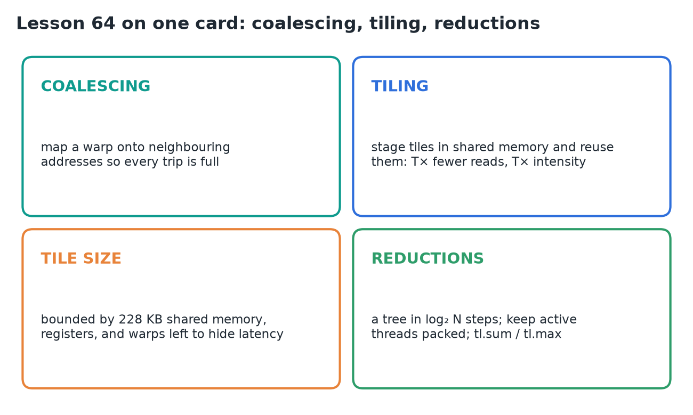

# 64 · Coalescing, Tiling & Reductions

**Source:** [fanout.sh / inference-eng / 13-03](https://fanout.sh/inference-eng/curriculum/13-03) · ~7 min

> [!NOTE]
> Three tools make GPU kernels fast. **Coalescing** maps a warp's 32 threads onto neighbouring addresses, so each trip to memory comes back full. **Tiling** stages tiles in shared memory and reuses them, which cuts HBM traffic and raises arithmetic intensity by the **tile width T**. **Reductions** combine many values in a **tree of log₂ N steps**, keeping active threads packed to avoid divergence. Simon Boehm's matmul worklog shows the payoff: from **1.3%** of cuBLAS to **94%**.

## 1. One matmul, made fast

*Boehm's FP32 matmul on an RTX A6000, as a share of cuBLAS on the same GPU.*

- The **naive kernel** reached about **1.3%** of cuBLAS.
- Just **changing which thread reads which address** took it to 8.5%, which is **6.4× faster** with the same math.
- Keeping data **on chip and reusing it** climbed through **13%**, then **69%**, then **94%**.

## 2. Coalescing in two dimensions

*Same threads, same math; only the mapping of the warp onto C changes.*

- A matrix is stored **row by row**, so walking along a row means walking through consecutive addresses.
- Each thread computes **one output of C**. The question is how a warp's 32 threads are laid over C.
- **Down a column of C:** each thread needs a **different row of A**, so the warp makes **32 scattered reads**.
- **Along a row of C:** every thread needs the **same row of A**, which is one **broadcast**, and **neighbouring columns of B**, which are neighbouring addresses.
- In Boehm's measurements memory throughput jumped from about **15 GB/s to over 100 GB/s**.

## 3. Tiling: fewer trips

*Coalescing makes each trip efficient; tiling makes fewer trips.*

- One output of C needs a **full row of A and a full column of B**, and its right-hand neighbour needs **that same row of A again**.
- In the naive kernel every output fetches its own row and column from HBM, so **each input number is read N times**.

$$\text{naive reads} \approx 2N^3 = 2 \times 4{,}096^3 \approx 1.4 \times 10^{11}$$

- **Tiling:** a block of threads owns a **T × T tile of C**, say 32 × 32. It walks along the shared dimension, and at each step it loads **one tile of A and one tile of B into shared memory, once**.
- All **1,024 threads** then reuse those tiles from on chip, at shared-memory speed.
- Each number is now fetched from HBM **once per tile instead of once per output**, so traffic drops by the tile width:

$$\frac{2N^3}{T} = \frac{1.4 \times 10^{11}}{32} \approx 4.3 \times 10^{9}\ \text{reads}$$

## 4. Picking the tile size

*Left: A + B tiles in BF16 against shared memory. Right: ◆ the intensity each tile size buys.*

- **On the roofline:** fewer bytes for the same FLOPs means higher arithmetic intensity, and **tile width T raises it by roughly T**.
- **Why not enormous tiles?** They must fit on chip. Shared memory is at most about **228 KB per SM**, and registers are limited too. In BF16 the A + B tiles take 2 × T² × 2 bytes: **4 KB at T = 32, 64 KB at 128, 256 KB at 256**, which no longer fits.
- **Bigger tiles also mean fewer blocks**, so fewer warps to hide latency with. Picking the size is a balancing act.
- **Register tiles:** real kernels go one level further. Each thread computes a **small patch of outputs held in registers**, so reuse happens even closer to the math. That is how Boehm climbed from 13% to 69% to 94%.
- ◆ **The lesson's chart places T = 32 near the ridge; the numbers don't.** A T × T tile does 2T² FLOPs per k-step while loading 2T elements of 2 bytes each, so its intensity is **T / 2 FLOP/byte**: only **16 at T = 32**, against the H100 BF16 ridge of ≈ 295. That is why production kernels use 128-wide tiles or larger, register tiles, and L2 reuse across blocks.

## 5. Reductions: many inputs, one output

*Each step adds all pairs at once and halves the count.*

- Some outputs depend on many inputs at once, like **the sum of a whole row**.
- **One thread in a loop** adds 1,024 numbers in **1,023 steps** while every other thread waits.
- **Add in a tree:** pair the numbers up and add all pairs at the same time, then pair the results, and again. 1,024 numbers take just **log₂ 1,024 = 10 steps**.
- **Big reductions go in levels:** each block reduces its own tile to one partial result, and a **second pass combines the partials**.
- **Inside a warp**, threads can pass values directly between registers with **shuffle instructions**: 32 values in **5 steps**, no shared memory.

## 6. The divergence trap

*Same tree, two ways of choosing which threads add.*

- **The obvious version:** at each step, threads with an even index add their neighbour, then every fourth thread, then every eighth. Active and idle threads are **interleaved inside every warp**, which is divergence, and **every warp stays busy doing a trickle of work**.
- **The fix:** keep active threads packed. The **first half adds the second half**, then the first quarter, and so on. Now **whole warps go idle and drop out**, while the remaining warps run at full width.
- Mark Harris's classic NVIDIA talk walked through **7 versions** of this one reduction and got about **30× faster** in total.
- **Reductions are everywhere in inference:** the max and the sum in **softmax**, the sum of squares in **RMSNorm**, picking the top tokens when **sampling**.
- **In Triton** you write `tl.sum` or `tl.max`, and the compiler builds the tree for you.

## 7. Recap

Next: the most important kernel in inference, profiling **attention** and where its memory goes.
