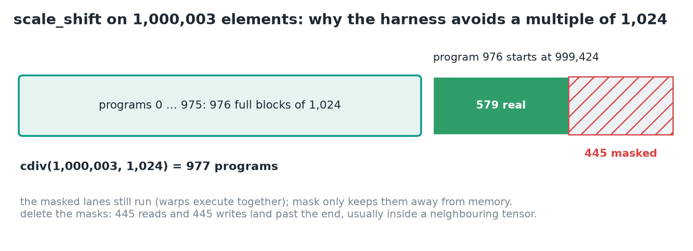
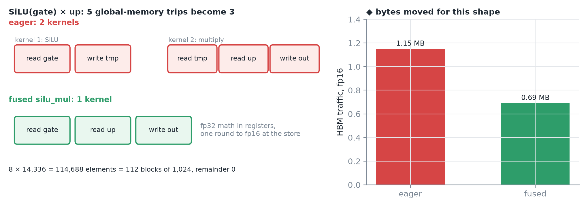
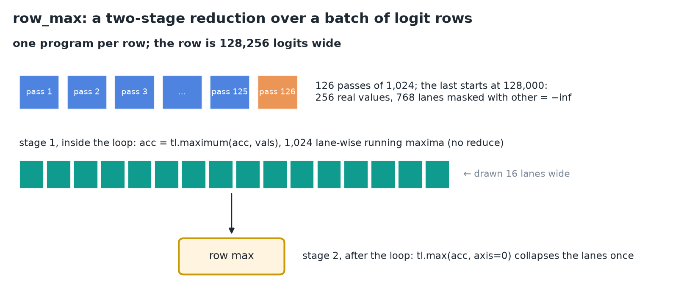
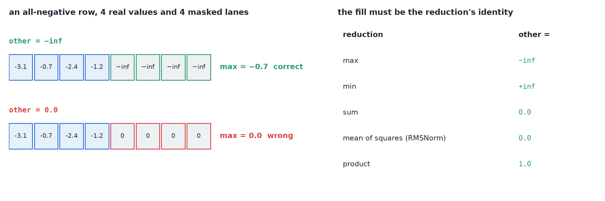
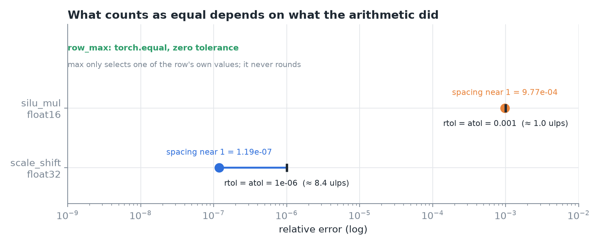
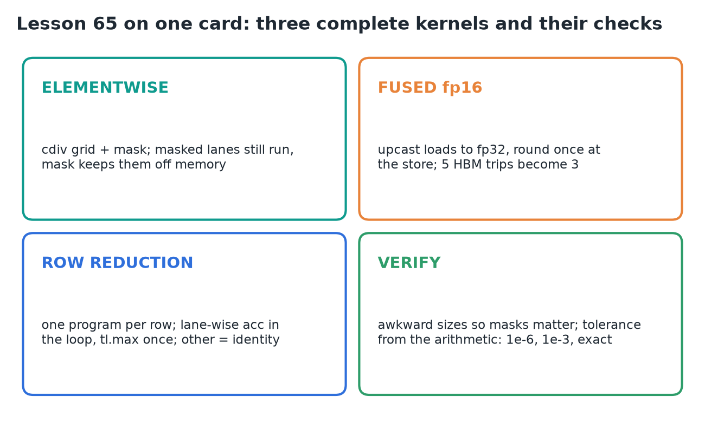

# 65 · Write Vector & Reduction Kernels

**Source:** [fanout.sh / inference-eng / 13-04](https://fanout.sh/inference-eng/curriculum/13-04) · ~8 min (text lesson)

> [!NOTE]
> The module's first **complete** Triton kernels, each with its launch wrapper and a harness that checks it against the eager op it replaces: an elementwise **scale and shift**, the fused **SiLU × up** from the MLP, and a rowwise **max**. Three habits carry the lesson: test on **awkward sizes** so the masks actually matter, do **fp16 math in fp32 and round once**, and fill masked lanes with the **reduction's identity** whenever they flow into arithmetic. Tolerances come from the arithmetic: **1e-6** for fp32, **1e-3** for fp16, **exact** for max. The lesson's author had no NVIDIA GPU, so the kernels are unrun; the harness is the proof you run yourself.

## 1. A first complete kernel: `a * x + b`


*The harness picks 1,000,003 elements because 1,024 does not divide it.*

```python
BLOCK_SIZE = 1024

@triton.jit
def scale_shift_kernel(x_ptr, out_ptr, a, b, n_elements, BLOCK_SIZE: tl.constexpr):
    pid = tl.program_id(axis=0)
    offsets = pid * BLOCK_SIZE + tl.arange(0, BLOCK_SIZE)
    mask = offsets < n_elements
    x = tl.load(x_ptr + offsets, mask=mask)
    tl.store(out_ptr + offsets, a * x + b, mask=mask)

def scale_shift(x, a, b):
    assert x.is_cuda and x.is_contiguous()
    out = torch.empty_like(x)
    grid = (triton.cdiv(x.numel(), BLOCK_SIZE),)
    scale_shift_kernel[grid](x, out, a, b, x.numel(), BLOCK_SIZE=BLOCK_SIZE)
    return out
```

- **The launcher's one decision is the grid.** `cdiv(1,000,003, 1,024)` rounds up to **977 programs**. The first 976 are full; the last starts at 976 × 1,024 = **999,424** and has only **579** real elements, so **445 lanes** have nothing to do.
- **Those 445 lanes still run**, because a warp executes together whatever the data looks like. The **mask** is what keeps them away from memory.
- **A masked load returns undefined values** when `other` is not given. That's fine here because the garbage stays private: those lanes compute `a * garbage + b` and the masked store throws it away.

> [!WARNING]
> **Out-of-bounds kernels don't reliably crash.** Delete both masks and 445 loads read past the end of `x` while 445 stores write past the end of `out`. Inside PyTorch the allocator hands out device memory in large slabs, so those addresses usually land in **another tensor**, and the bug shows up later as numbers that are merely wrong. On a size the block divides evenly, deleting the masks changes nothing, and **a test that cannot fail is not a test**.

## 2. Two loads, one store: fused SiLU × up


*◆ Byte counts are my arithmetic for the harness shape, 2 bytes per fp16 element.*

```python
@triton.jit
def silu_mul_kernel(gate_ptr, up_ptr, out_ptr, n_elements, BLOCK_SIZE: tl.constexpr):
    pid = tl.program_id(axis=0)
    offsets = pid * BLOCK_SIZE + tl.arange(0, BLOCK_SIZE)
    mask = offsets < n_elements
    gate = tl.load(gate_ptr + offsets, mask=mask).to(tl.float32)
    up = tl.load(up_ptr + offsets, mask=mask).to(tl.float32)
    result = gate * tl.sigmoid(gate) * up
    tl.store(out_ptr + offsets, result.to(tl.float16), mask=mask)
```

- This is the middle of the MLP: it widens each position to **14,336** twice, passes the **gate** side through SiLU, and multiplies it elementwise by the **up** side.
- **Tensors live in fp16; the arithmetic shouldn't.** Each load is upcast to fp32 before any math, so the sigmoid (1 / (1 + exp(−x))) runs in fp32, and the result is **rounded to fp16 exactly once**, at the store.
- **Harness shape:** 8 rows × 14,336 = **114,688** elements, which is **112 blocks** of 1,024 with remainder 0, so no lane is masked. The mask stays anyway, because the kernel can't know which callers it will meet.
- **Fusion turns 5 global-memory trips into 3.** Eager SiLU reads gate and writes a temporary; the eager multiply reads the temporary and up and writes out. The fused kernel reads gate and up and writes out.
- ◆ For this shape each trip is 114,688 × 2 B ≈ 0.23 MB, so eager moves **≈ 1.15 MB** and fused **≈ 0.69 MB**, about **1.7× less traffic**. Whether that wins on a clock is a measurement for the benchmarking lesson.
- ◆ The wrapper asserts `gate.is_cuda` but not `up.is_cuda`; a CPU `up` would only fail inside the launch.

## 3. One program per row: `row_max`


*The two-stage reduction: lane-wise running maxima in the loop, one collapse after it.*

```python
@triton.jit
def row_max_kernel(x_ptr, out_ptr, n_cols, stride_row, BLOCK_SIZE: tl.constexpr):
    row = tl.program_id(axis=0)
    row_ptr = x_ptr + row * stride_row
    acc = tl.full([BLOCK_SIZE], value=float("-inf"), dtype=tl.float32)
    for block_start in range(0, n_cols, BLOCK_SIZE):
        offsets = block_start + tl.arange(0, BLOCK_SIZE)
        mask = offsets < n_cols
        vals = tl.load(row_ptr + offsets, mask=mask, other=float("-inf")).to(tl.float32)
        acc = tl.maximum(acc, vals)
    tl.store(out_ptr + row, tl.max(acc, axis=0))

# launcher: grid = (n_rows,), passes x.stride(0) as stride_row
```

- **What a program owns changes.** The grid is no longer a division: it's **one program per row**, and each program walks its whole row in `BLOCK_SIZE` steps. This is the idiom of Triton's layer-norm tutorial.
- **Stage 1, inside the loop:** the program never reduces. `acc` holds **1,024 independent running maxima**, one per lane, advanced by `tl.maximum` each pass.
- **Stage 2, after the loop:** `tl.max(acc, axis=0)` collapses the lanes into the row's answer, once.
- **Harness shape:** rows of **128,256** logits (the vocabulary width), so the loop runs ⌈128,256 / 1,024⌉ = **126 times**. The last pass starts at 125 × 1,024 = **128,000** with **256 real values and 768 masked lanes**.
- ◆ With 8 rows the grid is **8 programs on 132 SMs**, so most of an H100 sits idle. Fine for correctness; a production kernel for small batches splits each row across several programs.

## 4. Why `other` stops being optional


*The masked lanes now flow into the arithmetic, so their fill must be the value that can't win.*

- In `row_max` a masked lane's stand-in enters `tl.maximum` like a real value. It must be **−inf, the identity of max**.
- **Filling with 0.0** would pass this harness almost every time and be **silently wrong for any all-negative row**, returning 0.0 instead of the true maximum.
- **The right fill depends on the reduction:** a row sum wants 0.0, and so does RMSNorm's mean of squares.
- ◆ `tl.maximum` does not propagate NaN by default, while `torch.amax` does. With NaN logits the two would disagree; the harness's `randn` input never has any.

## 5. What counts as equal


*◆ The ulp counts are my arithmetic.*

```python
x = torch.randn(1_000_003, device="cuda")
assert torch.allclose(scale_shift(x, 1.5, -2.0), 1.5 * x - 2.0, rtol=1e-6, atol=1e-6)

gate = torch.randn(8, 14336, device="cuda", dtype=torch.float16)
up = torch.randn(8, 14336, device="cuda", dtype=torch.float16)
assert torch.allclose(silu_mul(gate, up), F.silu(gate) * up, rtol=1e-3, atol=1e-3)

logits = torch.randn(8, 128256, device="cuda")
assert torch.equal(row_max(logits), torch.amax(logits, dim=1))
```

- **fp32, `scale_shift`:** eager rounds after each of its two ops, while the compiler may fuse `a * x + b` into one **FMA** that rounds once. The difference is on the order of fp32's spacing near 1, **2⁻²³ ≈ 1.2e-7**, so 1e-6 gives a few ulps of headroom (◆ ≈ 8.4).
- ◆ The **atol** matters where 1.5x − 2 is near zero (x ≈ 4/3): the FMA difference is an ulp of 1.5x ≈ 2, which is huge relative to the tiny result, but well under 1e-6 absolute.
- **fp16, `silu_mul`:** the eager reference rounds to fp16 **twice** (when `F.silu` materializes, and after the multiply); the fused kernel rounds **once**. Neighbouring fp16 values near 1.0 are **2⁻¹⁰ ≈ 9.8e-4** apart, so 1e-3 is one fp16 step.
- **max, `row_max`:** a maximum only compares and selects, so the answer is one of the row's own values. The check is **`torch.equal`, no tolerance**.
- **No output is printed on the lesson page**, because none was produced there. Run the file; three `ok` lines should print. If an assertion trips, the **Triton interpreter** steps the failing kernel op by op without a GPU.

## 6. The same shapes inside a decode step

- **Elementwise shape:** the MLP's activation stage, in every layer for every token; `silu_mul` is that stage at its real width.
- **Reduction shape:** wherever a step summarizes a vector: the **mean of squares** in RMSNorm, the **row max and row sum** in softmax, and **greedy argmax** in sampling, which is `row_max` keeping the winner's index instead of its value.
- Serving engines ship these shapes as dedicated kernels (vLLM's Triton files are the existence proof).
- **Next: softmax and RMSNorm kernels**, which compose the two: an elementwise pass that can't start until a reduction has answered.

## 7. Recap


