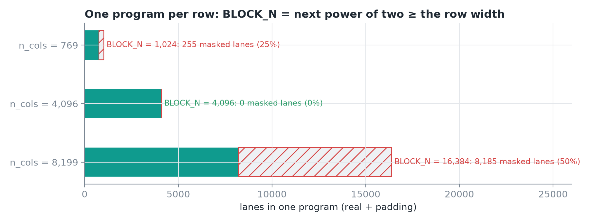
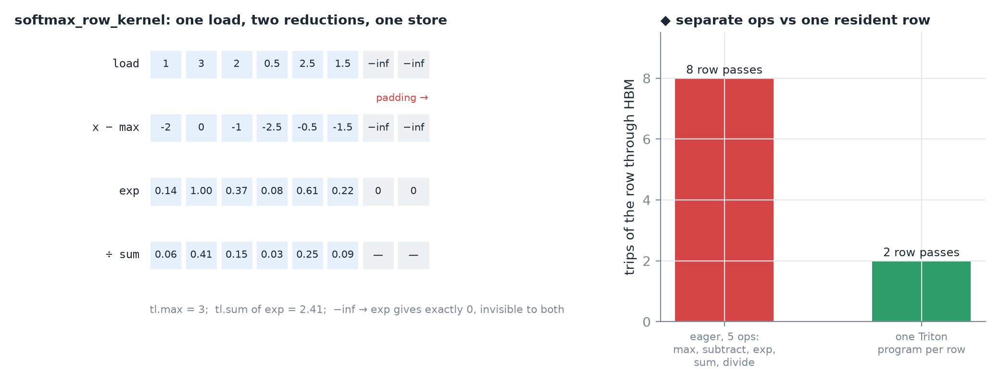
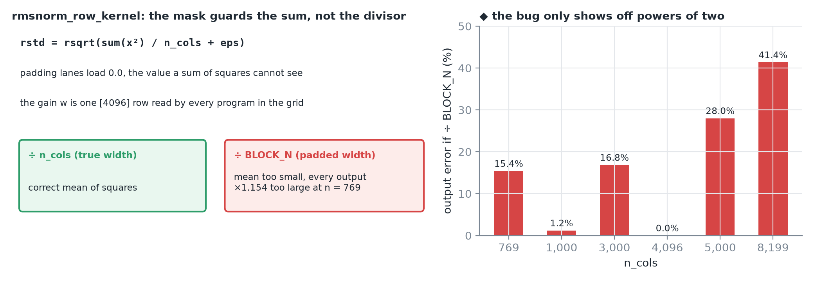
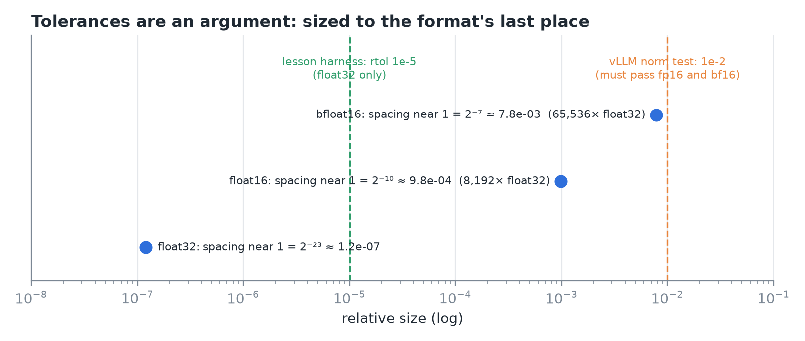
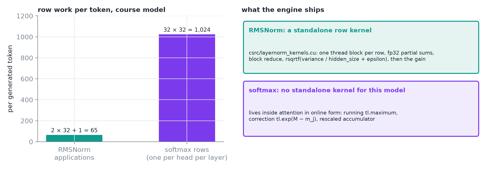
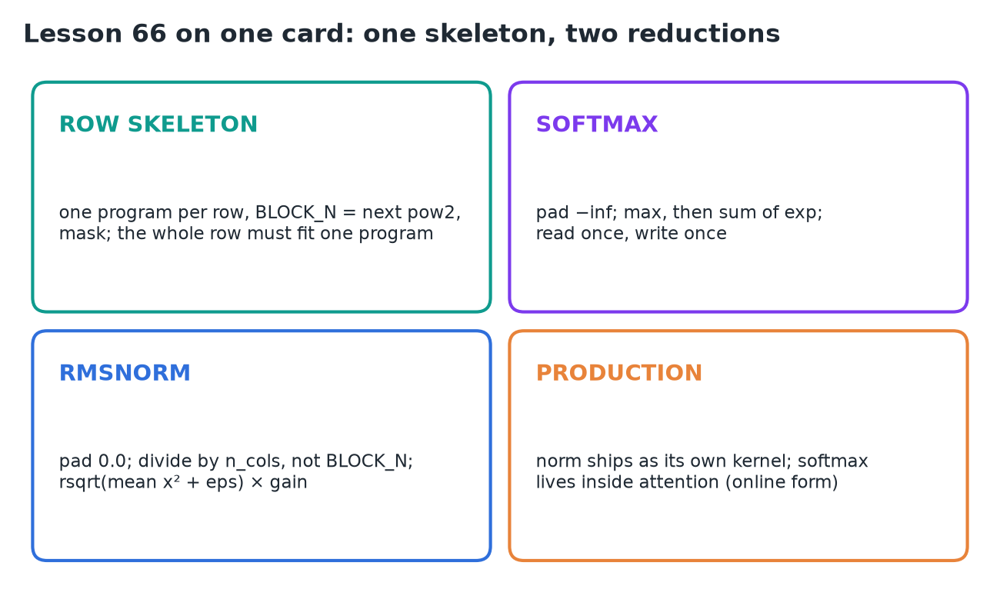

# 66 · Write Softmax & RMSNorm

**Source:** [fanout.sh / inference-eng / 13-05](https://fanout.sh/inference-eng/curriculum/13-05) · ~8 min (text lesson)

> [!NOTE]
> Softmax and RMSNorm share one shape: **read a row, reduce it to a scalar, rescale the row by that scalar**. Both are written as Triton kernels with **one program per row** and **BLOCK_N = the next power of two** above the row width, so the whole row must fit in one program. Only the slots change: softmax pads with **−inf** and reduces with a max and a sum; RMSNorm pads with **0.0**, reduces a sum of squares and must divide by **n_cols, not BLOCK_N**. In production the engine ships RMSNorm as its own kernel, but **softmax lives inside attention** in the online form.

## 1. A whole row in one program


*◆ The masked-lane counts for 769 and 8,199 are my arithmetic.*

- **Grid:** one-dimensional, one program per row, so `tl.program_id` names the row.
- **Lanes:** `BLOCK_N = triton.next_power_of_2(n_cols)`, `tl.arange(0, BLOCK_N)` spans the row, and a mask retires the lanes past the end. A Triton block must hold a power-of-two number of elements, so the row is **padded up and the memory ops guarded**.
- **At the course's hidden width of 4,096**, BLOCK_N lands exactly on 4,096 and nothing is masked.
- **The constraint comes before any code:** the whole row must fit in one program. A row that grows without bound, like attention scores at long context, fits in nothing fixed. The escape is the **online-softmax rewrite**, which never needs the finished row, not a bigger block.
- **In front of a reduction, the mask does a second job:** besides deciding which lanes touch memory, it decides **what the retired lanes contribute**, so each kernel must choose its padding value.
- ◆ Padding cost depends on where the width lands: 769 needs 1,024 lanes (**25% masked**), and 8,199 needs 16,384 (**50% masked**).

## 2. The softmax kernel


*Left: a 6-wide row padded to 8 lanes. Right: ◆ row passes, my count.*

```python
@triton.jit
def softmax_row_kernel(x_ptr, out_ptr, n_cols, BLOCK_N: tl.constexpr):
    row = tl.program_id(axis=0)
    cols = tl.arange(0, BLOCK_N)
    mask = cols < n_cols
    x = tl.load(x_ptr + row * n_cols + cols, mask=mask, other=-float("inf"))
    x = x - tl.max(x, axis=0)
    numerator = tl.exp(x)
    denominator = tl.sum(numerator, axis=0)
    tl.store(out_ptr + row * n_cols + cols, numerator / denominator, mask=mask)

# wrapper: BLOCK_N = triton.next_power_of_2(n_cols); grid = (n_rows,)
```

- **Read down the body:** one masked load, `tl.max` for the row maximum, subtract it so the largest exponent is e⁰ and **nothing can overflow**, `tl.exp` for numerators, `tl.sum` for the denominator, one masked store.
- **One padding value serves both reductions:** −inf can't win the maximum, and it exponentiates to **exactly 0**, so it can't enter the sum either.
- **The row exists once, in registers**, between the load and the store. Run as separate eager ops, each intermediate (shifted scores, exponentials, weights) goes to global memory and comes back.
- ◆ Separate eager ops move the row **8 times** (max reads; subtract, exp and divide each read and write; sum reads), against **2** here: 4× the traffic. `torch.softmax` itself is already one fused kernel, so the harness reference isn't the slow path.

## 3. The RMSNorm kernel


*Right: ◆ how wrong every output gets if you divide by BLOCK_N, my arithmetic.*

$$y = \frac{x}{\sqrt{\mathrm{mean}(x^2) + \varepsilon}} \cdot g, \qquad \varepsilon = 10^{-5}$$

```python
@triton.jit
def rmsnorm_row_kernel(x_ptr, w_ptr, out_ptr, n_cols, eps, BLOCK_N: tl.constexpr):
    row = tl.program_id(axis=0)
    cols = tl.arange(0, BLOCK_N)
    mask = cols < n_cols
    x = tl.load(x_ptr + row * n_cols + cols, mask=mask, other=0.0)
    mean_sq = tl.sum(x * x, axis=0) / n_cols
    rstd = tl.rsqrt(mean_sq + eps)
    w = tl.load(w_ptr + cols, mask=mask, other=0.0)
    tl.store(out_ptr + row * n_cols + cols, x * rstd * w, mask=mask)
```

- **ε = 1e-5 (`rms_norm_eps`) sits inside the root**, so a near-zero row can't divide by zero.
- **Padding flips to 0.0**, the value a sum of squares can't see. **The neutral element belongs to the reduction, not to the mask.**
- **Divide by `n_cols`, never `BLOCK_N`.** The mask keeps padding out of the sum, but nothing keeps the divisor honest except you.
- ◆ At width 769, dividing by 1,024 makes the mean too small by 769/1,024, so rstd and **every output are √(1,024/769) ≈ 1.154×, 15.4% too large**. At 4,096 the bug is invisible, which is why the harness must also run an odd width.
- **A second pointer:** the learned gain is one [4,096] row that **every program reads**; softmax needed nothing beyond the row itself.
- ◆ Neither kernel upcasts. The harness is fp32, so that's fine, but with fp16 activations, follow lesson 65 and add `.to(tl.float32)` on the load. If the squares were summed in fp16 at the harness scale (x = 4 × randn, so x² averages 16), 4,096 × 16 = 65,536 would already pass fp16's maximum of 65,504.

## 4. The shape they share

| slot | softmax | RMSNorm |
|---|---|---|
| padding value | `-inf` | `0.0` |
| reductions | max, then sum of exponentials | one sum of squares |
| scalar the row waits on | the denominator | rsqrt(mean(x²) + ε) |
| elementwise tail | exp(x − m) / denominator | x · rstd · g |
| second input | none | the gain, one row for the whole grid |

- **Everything else is identical:** the grid, `tl.program_id` row arithmetic, offsets, mask, one visit to each element on the way in and one on the way out.
- **A row kernel is a skeleton** you've now filled twice; the rest of the module edits its slots instead of starting over.

## 5. The harness and its tolerances


*◆ The format ratios are my arithmetic.*

```python
x = torch.randn(64, 4096, device="cuda") * 4.0
torch.allclose(softmax_rows(x), torch.softmax(x, dim=1), rtol=1e-5, atol=1e-6)

def rmsnorm_reference(x, weight, eps=1e-5):
    rms = torch.sqrt(x.pow(2).mean(dim=1, keepdim=True) + eps)
    return (x / rms) * weight

weight = torch.empty(4096, device="cuda").normal_(mean=1.0, std=0.1)
torch.allclose(rmsnorm_rows(x, weight), rmsnorm_reference(x, weight), rtol=1e-5, atol=1e-6)
```

- **References:** `torch.softmax` for softmax; for RMSNorm the formula in tensor ops, the role `forward_native` plays inside the engine.
- **Why 1e-5 is defensible:** everything is fp32, outputs are order-one (weights ≤ 1, normed entries near the gain), and the kernels' two liberties are small. `tl.exp` is "fast but approximate (think `__expf`)", and reductions **add in a different order**, which moves only the last places. 1e-5 sits far above both; **bit equality is deliberately not demanded**.
- **vLLM's own norm test loosens to atol = rtol = 1e-2**, because reductions carry larger errors and the same test must pass in fp16 and bf16. ◆ Their last places are **8,192×** and **65,536×** coarser than fp32's.
- **Run it twice.** 4,096 is a power of two, so the masks never fire. Change it to **769** and run again, the trick vLLM's test plays with 769 and 8,199.
- **If a check prints False, suspect in order:** the padding value, then the `n_cols` divisor, then the mask itself. Without a GPU, the Triton interpreter steps the kernels on CPU.

## 6. What the engine ships


*Per generated token on the course model (32 blocks, 32 query heads).*

- **RMSNorm runs 65 times per token:** 2 per block × 32 blocks + the final norm, one for each of the 65 [4,096] gains.
- **vLLM's RMSNorm** is this page's shape in CUDA: `csrc/layernorm_kernels.cu` gives each row to **one thread block**, accumulates partial sums of squares **in fp32**, reduces across the block and computes `rsqrtf(variance / hidden_size + epsilon)` before the gain. `RMSNorm.forward_cuda` in `layernorm.py` picks it over the eager form.
- **A Triton version** ships on the Mamba path (`layernorm_gated.py`): one program per row, masked whole-row load, `1 / tl.sqrt(var + eps)`. Its wrapper refuses rows too wide for one block: *"This layer norm doesn't support feature dim >= 64KB"*. ◆ The limit is in bytes, so it's about 16K elements in fp32 and 32K in fp16 or bf16.
- **Softmax runs on even more rows:** one per head per block, **32 × 32 = 1,024 rows per token**, yet vLLM ships **no standalone softmax** for this model. The only custom one outside attention serves MoE routing.
- **Attention softmax lives inside the attention kernel in online form:** `triton_unified_attention.py` uses the same ops, a running max via `tl.maximum`, the correction `tl.exp(M - m_j)` and a rescaled accumulator. A row of scores is worth exponentiating **while it's still resident**.
- **Next:** `fused_add_rms_norm` sits beside `rms_norm` and absorbs the residual add, so the stream is touched once instead of twice.

## 7. Recap


