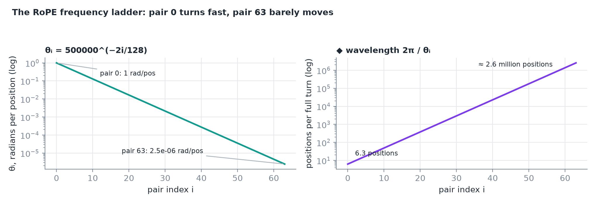
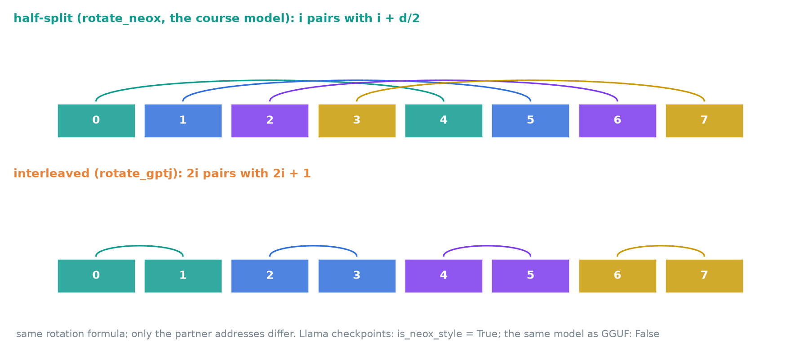
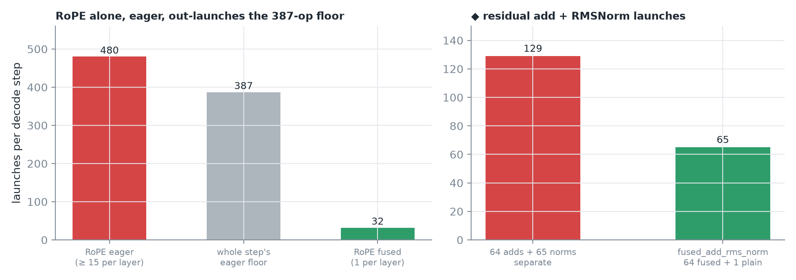
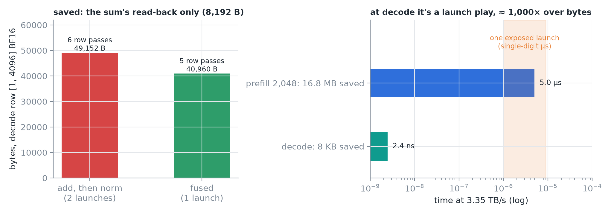
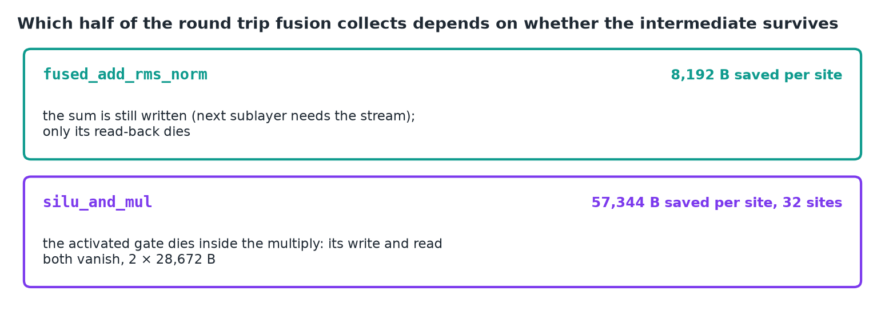
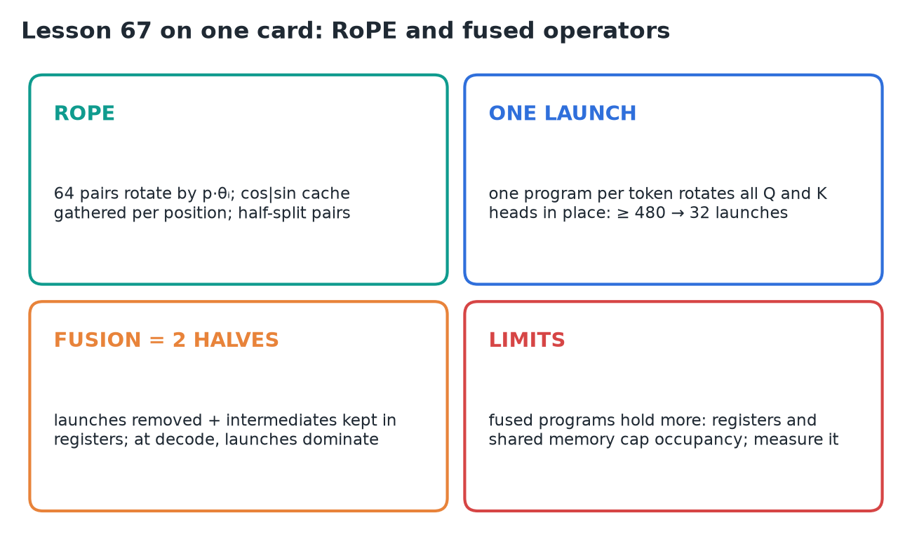

# 67 · Write RoPE & Fused Operators

**Source:** [fanout.sh / inference-eng / 13-06](https://fanout.sh/inference-eng/curriculum/13-06) · ~8 min (text lesson)

> [!NOTE]
> **RoPE** rotates each query and key head as **64 pairs**, each by an angle p·θᵢ from a frequency ladder, using a precomputed **cos | sin cache**. Which elements pair up is a **checkpoint convention** (half-split for Llama, interleaved for the same model as GGUF), and the wrong one fails silently. vLLM rotates all Q and K heads of a token in **one in-place launch**, turning ≥ 480 eager launches per step into **32**. Fusion has two halves, **fewer launches** and **intermediates kept in registers**; at decode shapes the launch half dominates by about **1,000×**. Fused programs hold more state, so registers and shared memory can cap occupancy, and only a measurement settles it.

## 1. What RoPE computes


*◆ The wavelengths are my arithmetic.*

- **Why:** attention treats its rows as a set, so each Q and K row is **rotated by an angle that depends on its position** before the dot products, which makes scores position-aware.
- **The rotation:** a head's 128 values are **64 pairs**, each turned like a point in a plane. For pair i of a token at position p:

$$o_1 = x_1\cos(p\theta_i) - x_2\sin(p\theta_i), \qquad o_2 = x_2\cos(p\theta_i) + x_1\sin(p\theta_i)$$

- **The ladder:** `inv_freq = 1 / (base ** (arange(0, 128, 2) / 128))` with `rope_theta = 500000`. Pair 0 turns 1 radian per position; pair 63 turns ≈ 2.5e-6.
- ◆ In full turns: pair 0 completes one every **2π ≈ 6.3 positions**, pair 63 every **≈ 2.6 million**.
- **No trig at runtime:** the engine fills a cache of shape **[max_position, 128]** once, with cosines in the left half and sines in the right. The kernel **gathers one row per position and multiplies**.
- **`rope_scaling`** is a subclass that overrides **only the ladder**. The rotation is untouched, so a kernel written against the pairs serves the scaled model unchanged.

## 2. Interleaved vs half-split


*Same rotation, different partners; the checkpoint decides.*

- **`rotate_gptj` (interleaved):** element 2i pairs with 2i + 1.
- **`rotate_neox` (half-split):** element i pairs with i + 64.
- **The course model is half-split:** vLLM sets `is_neox_style = True` for Llama checkpoints, but the **same model as GGUF flips it to False**. Same architecture, same formula, different container.
- **The wrong convention fails quietly:** nothing crashes, and every attention score drifts.
- **Address fact:** in half-split, x1 and x2 sit **64 elements = 128 bytes apart** in BF16, and each side is a contiguous 64-wide span.

## 3. One kernel for queries and keys

```python
@triton.jit
def rope_neox_kernel(positions_ptr, q_ptr, k_ptr, cache_ptr, q_stride, k_stride,
                     NUM_Q_PAIRS: tl.constexpr, NUM_K_PAIRS: tl.constexpr,
                     HEAD_SIZE: tl.constexpr, HALF: tl.constexpr, BLOCK: tl.constexpr):
    token = tl.program_id(axis=0)
    pos = tl.load(positions_ptr + token)
    cache_row = cache_ptr + pos * HEAD_SIZE
    offsets = tl.arange(0, BLOCK)            # one lane per (head, pair)
    head = offsets // HALF
    rot = offsets % HALF

    q_mask = offsets < NUM_Q_PAIRS
    cos = tl.load(cache_row + rot, mask=q_mask, other=0.0)
    sin = tl.load(cache_row + HALF + rot, mask=q_mask, other=0.0)
    q_base = q_ptr + token * q_stride + head * HEAD_SIZE
    x1 = tl.load(q_base + rot, mask=q_mask, other=0.0)
    x2 = tl.load(q_base + HALF + rot, mask=q_mask, other=0.0)
    tl.store(q_base + rot, x1 * cos - x2 * sin, mask=q_mask)
    tl.store(q_base + HALF + rot, x2 * cos + x1 * sin, mask=q_mask)

    k_mask = offsets < NUM_K_PAIRS             # same pattern for K, reusing cos/sin
    ...
```

- **One block per token**, rotating **every Q and K head of that token, in place**. vLLM's CUDA kernel says it in its first comment: *"Each thread block is responsible for one token."*
- **In place matters:** no output tensor to allocate or copy, so one pass over Q and K is all the traffic.
- **Lanes:** one `tl.arange` over head-and-pair space, split with `//` and `%`, the same flattening as the CUDA original.
- **The first fusion on the page:** the K side **reuses cos and sin already in registers**. Q and K rotation are two operators in the math and one kernel here.
- ◆ For the course model, BLOCK = next_pow2(32 × 64) = **2,048 lanes**. The Q side uses all of them; the K side uses **512** (8 heads × 64), so three quarters of the lanes idle through the K half.
- **Harness:** the eager reference `apply_rotary_emb_torch` is copied verbatim from vLLM; shapes are 32 Q heads, 8 KV heads, head size 128, 6 positions (BOS + the canonical prompt); `assert_close` uses torch's BF16 defaults, **rtol 1.6e-2, atol 1e-5**.
- ◆ **A risk in that tolerance:** eager BF16 rounds after each multiply and the subtraction, while the kernel may round differently (fp32 internally, or an FMA). Where x1·cos ≈ x2·sin the output is near zero, rtol gives no slack, and atol = 1e-5 is far below a BF16 step (2⁻⁷ ≈ 7.8e-3 relative). If the check trips only on near-zero elements, that's rounding order, not a wrong pairing.

## 4. What staying separate costs


*Right: ◆ launch counts for the add + norm fusion, my arithmetic.*

- **Eager RoPE launches per layer:** 1 gather, then per tensor 3 kernels for o1 (two multiplies, a subtract), 3 for o2, 1 for the cat: **1 + 2 × 7 = 15 at least**.
- **Across 32 layers that's ≥ 480 launches**, more than the entire **387-op eager floor** for the step, for ◆ (32 + 8) heads × 64 pairs × 6 FLOPs × 32 layers ≈ **0.49 million FLOPs** against the step's ≈ **16 billion**. Fused: **32 launches**.
- **Fusion's two halves:** **launches** (two programs become one, saving one launch's cost) and **bytes** (an intermediate that was written to global memory and read back now stays in registers).

## 5. The everyday fusion: residual add + RMSNorm


*Decode row [1, 4096] in BF16: one pass over the row is 8,192 bytes.*

```python
x = tl.load(x_ptr + row * x_stride + cols, mask=mask, other=0.0)
res = tl.load(residual_ptr + row * HIDDEN + cols, mask=mask, other=0.0)
summed = x.to(tl.float32) + res.to(tl.float32)            # cast, then add
tl.store(residual_ptr + row * HIDDEN + cols, summed.to(res.dtype), mask=mask)
variance = tl.sum(summed * summed, axis=0) / HIDDEN        # on the unrounded sum
rstd = 1.0 / tl.sqrt(variance + eps)
normed = (summed * rstd).to(x.dtype) * tl.load(weight_ptr + cols, mask=mask, other=0.0)
tl.store(x_ptr + row * x_stride + cols, normed, mask=mask)
```

- **Every sublayer entry** adds the residual stream and normalizes. On CUDA vLLM routes this to **`fused_add_rms_norm`**: one launch, in place on both tensors, returning the updated stream and the normed row.
- **Launch count:** 64 adds + 65 norms = 129 separate ops become **64 fused launches** plus the first block's entry norm, which runs plain because no stream exists yet. The final norm rides the last residual. ◆ **129 → 65 launches.**
- **Precision order is the engine's:** upcast, then add, so the variance uses the **unrounded sum**, while the stream stores the rounded copy.
- **Bytes at decode:** separate is add (read 2, write 1) + norm (read sum and weight, write 1) = 6 row passes = **49,152 B**. Fused is 3 reads + 2 writes = **40,960 B**.
- **Only the sum's read-back is saved (8,192 B).** Its write survives, because the next sublayer needs the stream.
- **8,192 B at 3.35 TB/s ≈ 2.4 ns**, while the launch it removes is worth **microseconds** exposed. At decode this fusion is a **launch play by about three orders of magnitude**; selling it as a bandwidth win means you haven't counted.
- **Prefill shifts the balance:** over 2,048 positions the saved read-back is ≈ **16.8 MB ≈ 5 µs**, the same scale as a launch. **The count decides.**

## 6. When the intermediate dies: `silu_and_mul`


*Fusion collects both halves of the round trip only when nothing else needs the intermediate.*

- `silu_and_mul` computes **silu(x[:d]) · x[d:]** in one program, so the activated gate (14,336 × 2 B = **28,672 B** at the decode row) is **never materialized**.
- It deletes the gate's **write and read: 57,344 B plus a launch per site**, at 32 sites a step.
- The residual stream only gives up the **read** half, because it must survive.

## 7. When two kernels beat one

- **A fused program holds more at once:** the sum has to live somewhere between add and normalize. More **registers per thread** or **shared memory per block** means fewer blocks per SM, lower occupancy and worse latency hiding.
- **vLLM's launcher shows the tension:** it calls the kernel *"memory-latency bound in many scenarios"* and **shrinks its block when tokens are plentiful**, because a smaller block allows more block occupancy and better latency hiding.
- **Where fusion stops paying** for a given kernel is a measurement; Nsight Compute's **`launch__occupancy_limit_registers`** and its siblings give the verdict.
- **Two boundaries:** fusing through the attention matmuls so the score matrix is never materialized is **FlashAttention**, a different algorithm; and chains of elementwise ops like these are what **`torch.compile`** fuses without a human.
- **Nothing here is timed.** Launches and bytes are counted because counts are checkable without a GPU; whether a fused kernel beats its pair on your card is the **kernel benchmarking** lesson.

## 8. Recap


