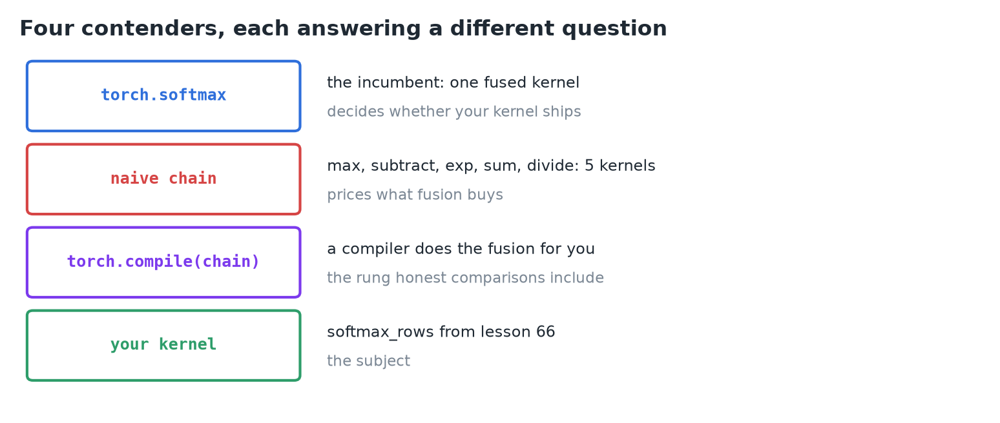
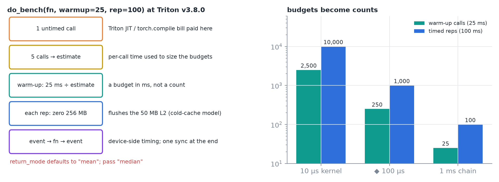
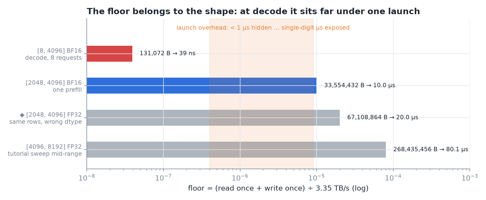
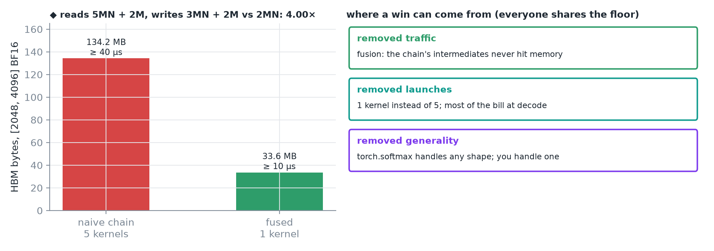
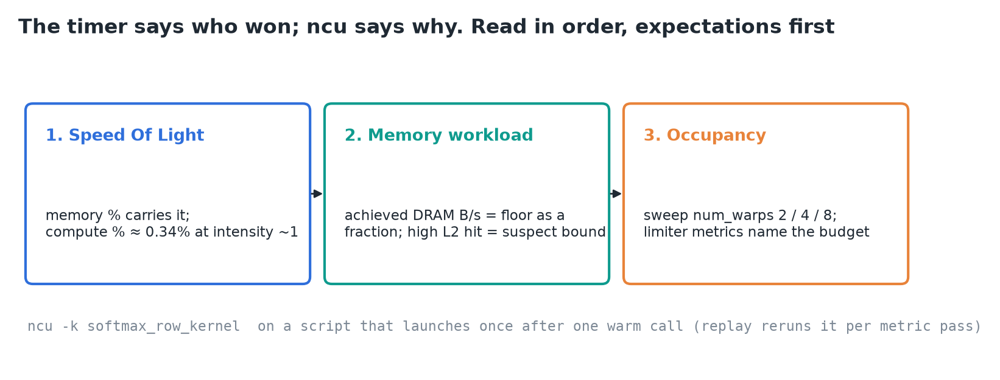
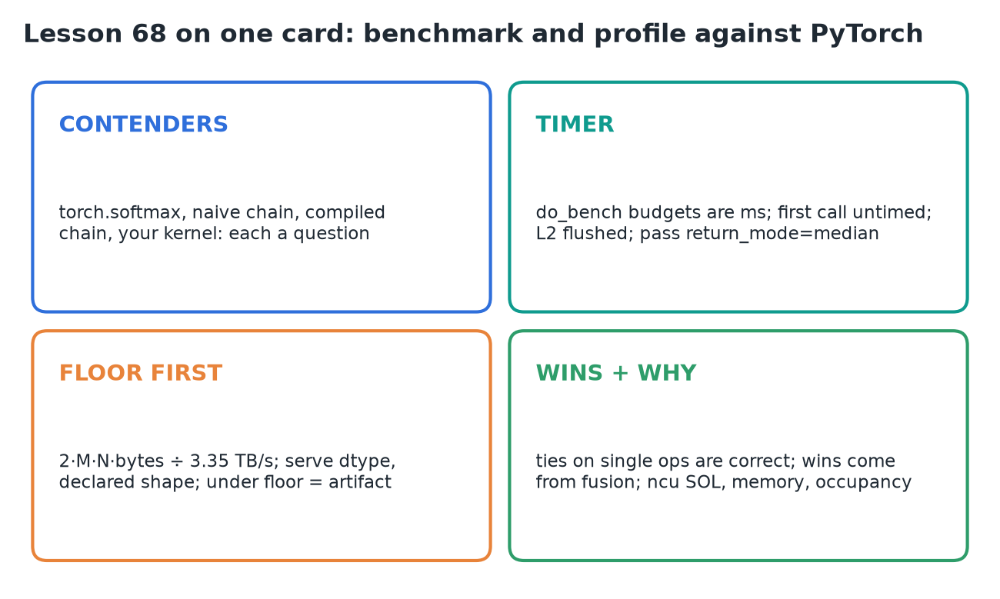

# 68 · Benchmark & Profile Against PyTorch

**Source:** [fanout.sh / inference-eng / 13-07](https://fanout.sh/inference-eng/curriculum/13-07) · ~7 min (text lesson)

> [!NOTE]
> A correct kernel hasn't earned anything until it's **measured against the operator it replaces**, at the model's real shapes, reproducibly. The protocol: pick **honest contenders** (including `torch.compile`), time with **`triton.testing.do_bench`** (whose `warmup` and `rep` are **millisecond budgets**, not counts) using **medians**, declare **shape and dtype**, and derive the **floor before the run**: (read once + write once) ÷ 3.35 TB/s. At decode shapes the floor is **39 ns**, far under one launch, so the timer reads dispatch, not bandwidth. **Ties on single operators are the correct outcome**; wins come from **fusion**. Then `ncu` says why: Speed Of Light, memory workload, occupancy.

## 1. The contenders


*The subject is lesson 66's softmax row kernel; the vector and fused kernels slot into the same ladder.*

- **`torch.softmax`:** the incumbent, already one fused kernel, and the **only rung that decides whether your kernel ships**.
- **The naive chain:** five eager ops (max, subtract, exp, sum, divide). It **prices what fusion buys**.
- **`torch.compile` over the chain:** a compiler doing the fusion with no kernel authorship. A Triton kernel that beats eager PyTorch but never meets the compiled version **has beaten the version nobody has to run**.

## 2. What the timer actually runs


*Triton v3.8.0, `testing.py`. ◆ The 100 µs column is my arithmetic.*

- **`do_bench(fn, warmup=25, rep=100)` doesn't run 25 warm-ups and 100 reps.** Both are **budgets in ms**: one untimed call, a 5-call estimate, then each budget ÷ the estimate gives the count. A **10 µs kernel gets 2,500 warm-ups and 10,000 reps**; a 1 ms chain gets 25 and 100.
- **Trap 1, timing the first call:** Triton JIT-compiles on first launch and `torch.compile` traces and builds on first call. The untimed call absorbs both; a hand-rolled loop that times call one reports the **compiler's bill as the kernel's**.
- **Device-side events** bracket each rep with one synchronize at the end, so asynchronous launches can't fool it.
- **Cold L2 by design:** before each rep it **zeroes a 256 MB buffer** so the input isn't already sitting in the **50 MB L2**. In a real forward pass the previous kernel just wrote your input through that cache, so whether cold-cache matches deployment is a judgment. **Record which case you measured.**
- **Fix the default:** `return_mode` defaults to **`"mean"`** (the softmax tutorial uses it). The course compares **medians**, so pass `return_mode="median"`. With `quantiles`, do_bench **interpolates** between ranks, unlike the nearest-rank convention used earlier.

## 3. The shapes the model runs, and their floors


*◆ The FP32 row at prefill shape is my addition.*

| Shape and dtype | Bytes (read + write) | Floor at 3.35 TB/s | What it is |
|---|---|---|---|
| [8, 4096] BF16 | 131,072 | 39 ns | one decode step, 8 running requests |
| [2048, 4096] BF16 | 33,554,432 | 10.0 µs | one 2,048-token prefill |
| [4096, 8192] FP32 | 268,435,456 | 80 µs | the official tutorial sweep's mid-range |

- **Decode:** a row kernel sees one row per running request, so 8 requests means **[8, 4096]**. Prefill of 2,048 tokens means **[2048, 4096]**. The tutorial sweeps neither: 4,096 rows, columns past 12,000, **FP32**.
- **The decode floor is absurd:** **39 ns** is under a tenth of the cheapest launch overhead and under a hundredth of an exposed one. At decode shapes **the timer reads dispatch and launch, not bandwidth**, and no kernel craft moves it. True and useful, but it's not a bandwidth verdict.
- **Trap 2, wrong dtype:** the model serves **BF16**. An FP32 baseline moves 2× the bytes (◆ 20 µs vs 10 µs at the prefill shape), and that **2× win belongs to the format, not the kernel**.
- **Trap 3, undeclared shape:** a kernel tuned and measured at the sweep's sizes says nothing about the 8-row step your engine actually launches. **Print the shape next to the number.**
- ◆ At [8, 4096] the one-program-per-row grid is **8 programs on 132 SMs**, another reason the decode number isn't about bandwidth.

## 4. The floor before the run

$$T_{\text{floor}} = \frac{2 \times 2048 \times 4096 \times 2\ \text{B}}{3.35\ \text{TB/s}} = \frac{33{,}554{,}432}{3.35 \times 10^{12}} \approx 10.0\ \mu\text{s}$$

- **The floor belongs to the shape**, not to any kernel, so it binds your kernel and torch's equally. Every median gets read against it.
- **A median under the floor is a harness artifact:** the input came from somewhere closer than HBM. The input here is **16.8 MB, a third of L2**, exactly what the cache flush exists to prevent.

```python
M, N = 2048, 4096                      # rerun with M = 8
x = torch.randn(M, N, device="cuda", dtype=torch.bfloat16)
torch.testing.assert_close(softmax_rows(x), torch.softmax(x, dim=-1), atol=1e-2, rtol=1e-2)

compiled_chain = torch.compile(naive_softmax)
contenders = [("torch.softmax",  lambda: torch.softmax(x, dim=-1)),
              ("naive chain",    lambda: naive_softmax(x)),
              ("compiled chain", lambda: compiled_chain(x)),
              ("your kernel",    lambda: softmax_rows(x))]

floor_us = 2 * M * N * x.element_size() / 3.35e12 * 1e6
print(f"floor at 3.35 TB/s, read once + write once: {floor_us:.1f} us")
for name, fn in contenders:
    ms = do_bench(fn, warmup=25, rep=100, return_mode="median")
    print(f"{name:14s} {ms * 1e3:8.1f} us")
```

- **Check correctness before timing:** a fast wrong kernel isn't a contender.
- **The floor prints first**, so every median lands next to the line it must answer to.

## 5. Where a win can come from


*◆ Byte totals and their floors are my arithmetic for the prefill shape.*

- **Everyone shares the floor**, so a win must change what moves:
  1. **Removed traffic.** The naive chain reads **5MN + 2M** elements and writes **3MN + 2M**; a fused kernel moves **2MN**. That's the tutorial's "theoretical speed-up of ~4×". ◆ At [2048, 4096] BF16: **134.2 MB (≥ 40 µs) vs 33.6 MB (≥ 10 µs)**.
  2. **Removed launches.** One kernel instead of five is four fewer launches, **most of the bill at the 39 ns end**.
  3. **Removed generality.** `torch.softmax` "is more general and will work on tensors of any shape"; a kernel specialized to one row width can trade that back as speed.
- ◆ **The 4× is a ceiling on fusion's gain here:** each 16.8 MB intermediate fits in the 50 MB L2, and do_bench flushes L2 only **before each rep, not between the chain's five kernels**, so the chain may read some intermediates from L2 and beat its 40 µs HBM floor.
- **Published comparisons travel badly.** The tutorial's "Triton is noticeably faster than torch.softmax" holds under its conditions (FP32, 4,096 rows, columns to 12,672, **means**, its card), and none of them is your BF16 decode step. Quote margins **with conditions attached**.

> [!TIP]
> **A correct kernel that only ties `torch.softmax` hasn't failed.** Two implementations saturating the same bandwidth are the same speed; for a single memory-bound op the tie is the **expected outcome**, confirming both kernel and harness. Separations live **where traffic was removed**, so go looking for wins in fusions.

## 6. The kernel under the profiler


*The Nsight Compute reading order, with expectations for a row kernel.*

- **The timer says who won; the profiler says why**, and why is what you can act on.
- **Two simplifications for Triton:** the kernel reaches `ncu` under the **decorated function's name**, so `-k softmax_row_kernel` matches exactly; and point `ncu` at a script that **launches once after one warm call**, not at the timing loop, since replay already reruns the launch per metric pass.
- **Speed Of Light:** a row kernel does a handful of ops per 4 bytes touched (intensity ~1), so **memory % carries the story** and compute % sits near **3.35 / 989 ≈ 0.34%**.
- **Memory workload:** achieved DRAM bytes/s is **your floor as a fraction**. A **high L2 hit rate** on traffic you counted as streamed reopens the bound before it says anything about the kernel.
- **Occupancy and `num_warps`** (default 4): more warps per program means more resident work until registers, shared memory or warp slots cap it; the **limiter metrics name which**. Sweep **num_warps = 2, 4, 8**, re-time each with the same `do_bench` line, and read achieved occupancy beside the medians. The tutorial settles on **8 for wide rows**.
- **`@triton.autotune`** is this sweep automated and keyed to input shapes, which brings back the declared-shape rule: **an autotuned kernel is tuned for the shapes somebody declared**.
- **Next:** the inference kernel challenge, a kernel that ships inside the engine, judged with this protocol.

## 7. Recap


